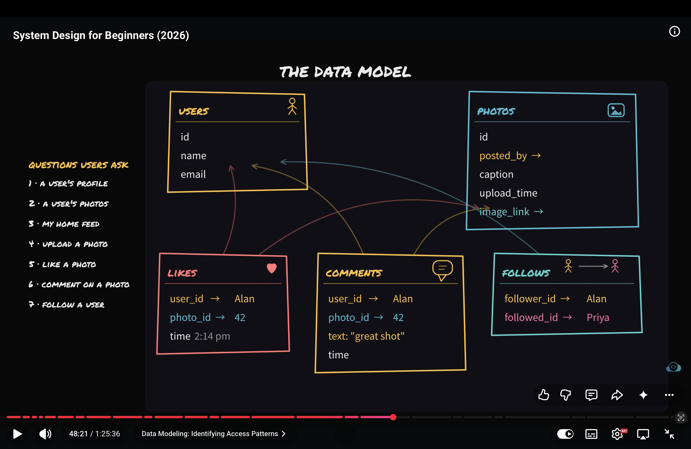

# What is ACID?
- The transaction is the group of db operations which should be taken as the single logical unit.
- ACID has 4 properties that makes db transaction relible.
- ACID is made up of 4 words.
- A -> Atomcity
- C -> Consistency
- I -> Isolation
- D -> Durability

1. Atomcity -> treat the txs as on all or nothing unit. if the single operation of db tx is being failed than whole tx is being rolled back.
2. Consistency -> Means db txs takes db from one valid state to another. Txs should follow all the db constraints, invariants, rules etc.
3. Isolation -> all the concurrent txs should be executed seprately from each other. to prevent data corruption.
4. Durability -> Means after commiting the txs the data in db should persist even after server crash.

# SQL vs NOSQL
1. SQL - The sql db stands for Structured Query Language db. the sql db follows the strict rows and columns scheema.
- the data in sql db is stored in rows and columns tables whcih follow strict scheema and relationship among tables.
- Scheema is implemented on the db level.
- For example mysql. postgressql etc
- The sql db is mostly scaled vertically but we can also horizontally scaled the sql db as our app grows.
- But sharding in sql db can be very complex operation to do because we implement very complex queries in sql like join from differnt shard can be very complex.
- We should use sql/relational db where we want structured data, complex relationships, transactions, constraints, and strong data integrity like backing apps.

2. NOSQL - The NOSQL db is the not only SQL db in which we can store data more felxibily and the scheema is not implemented at the db level.
- The data is more flexible in NOSQL DB which can lead to inconsistent db some time.
- NOSQL db is usually scaled horizontally means adding more machines in the db cluster.
- NOSQL db should be used in the cases where inconsisteny in data doesn't lead to catostrohic stituation for example social media apps.

# What is Data modelling.
- Data modeling is the process of deciding what data an application needs, how that data should be structured and stored, and how different pieces of data relate to each other.

- Example: In Inkflow, we identify entities such as User, Board, and Shape, define their fields, and decide how they connect using IDs and relationships.

- The first question I should ask before designing the Db.
- Is what will people ask this app to do?
- Access patterns are basically the ways your application needs to read, write, update, or delete data to fulfill user actions.
- Think of it like this:
- User action → Data operation → Database query
- User opens a board → Fetch its shapes → SELECT ... FROM shapes WHERE board_id = ?

- Why do access patterns matter in system design?
Suppose Inkflow has 1 million shapes stored in PostgreSQL.
- If users frequently load all shapes belonging to a particular board, you might add an index on board_id to help those queries run faster.

- User will ask Ques like
- A user's profile
- A user's photos
- My home feed
- upload a pic
- Like a photo
- Comment on photo
- Follow user.

- All these ques are what our app should do.
- What entity we find from these ques.
- User, photos, likes, comment, follows

- Aks ques what our app should do -> Find the entities - Relate the data 
- Access pattern : User need a home feed -> data operation -> db query

- 

# Choose sql if the data is structured means each entitiy will have same fields every time. And when we want relationship, txs etc. Use NOSQL when entitiy record can be different