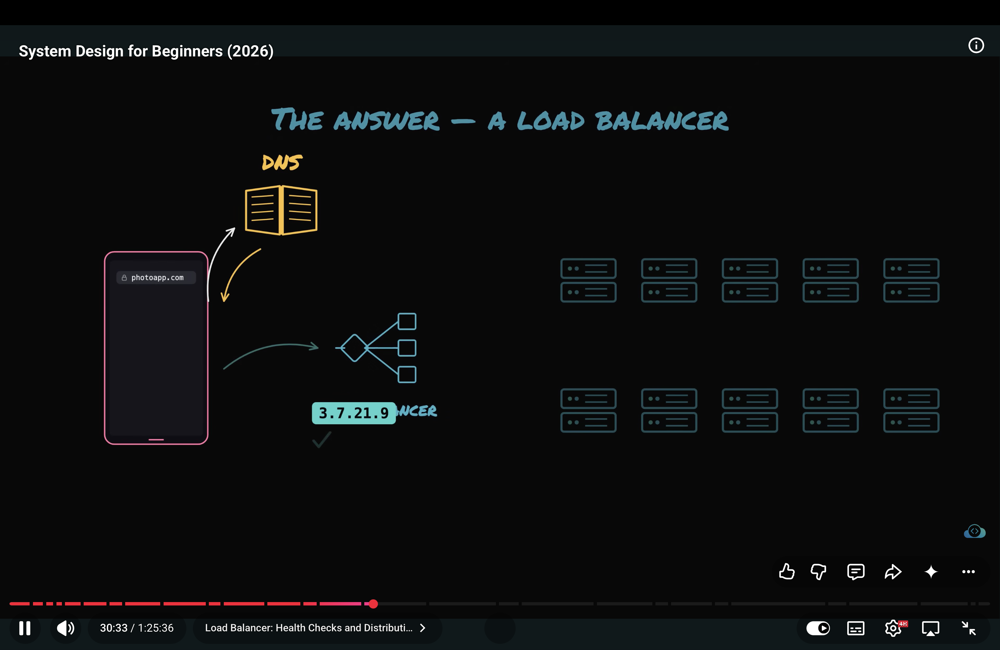
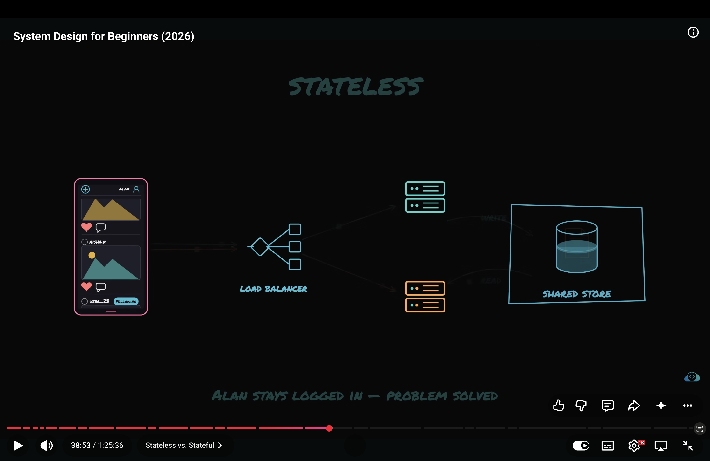
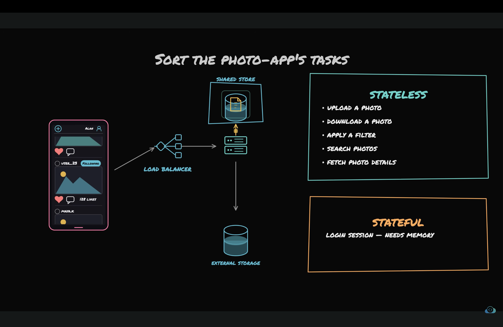

# What is LoadBalancer?
- As the app traffic grows, We scale our server horizontally.
- In horizontal scaling backend/microserivce is being hosted on multiple servers.
- Now clients have multiple servers to send requests. But clients are dumb and can't route the request to the appropraite server.
- That's why we need loadbalancer. It sits between the client and the mulitple servers and route the requests across available instances according to the routing algo to spread the load evenly. 
- LoadBalancer algo
1. Round robin algo - in this the clients request are send sequentiolly to the servers in the circullar order.
- if there are 3 machines 1 req will go to first first serer and 3 goes to 3rd servcer and 4th goes to 1st server again.
2. Weighted round robin algo -> In this the weights are attached to the servers according to there capacity and more reqs are routed to the servers which have more specs than other serer to manage the load.
3. Least connection algo -> In this the load balancer route the request to the server which have least connections with the load balancer.
4. Hash based algo -> this algo takes anything from user like client ip, user id etc as input and hash that to find the server. This ensures the same client is consistently is routed to the same server.

- In this DNS resolves the domain name to the loadBalancer IP address.
- Load Balancer server is calso called reverse proxy.
- It also does the health check for each server by pinging the server after some seconds. if the server doesn't resp LB will not route the req to it.

- 

# StateFull and Stateless.
1. When we move from one server to multiple servers and load balancer.
- Than the login session is also distrbuted as the traffic.
- For example user A is routed to server 1 and server 1 has user A session data.
- But when user A again visits the site the req is routed to server 2 and than server 2 will ask user A for re-login because server 2 doesn't have user session data.
- Different serves remember different users. Because each server is maintaining log in session we say these servers are stateful.
- Stateful server means when server keeps memory of previous req or store the data in server?

- A stateful server maintains information about previous interactions or the current state of a client or operation, and relies on that information to process subsequent requests.

For example, a server might store:
- A user's login session in RAM.
- A multi-step checkout process.
- An ongoing WebSocket connection and its associated room.
- Temporary information about an in-progress operation.

2. Stateless server stores nothing in it's own memory.
- Server handles the req sends the resp and foregets everything.

- But user login session data has to live somewhere, we dont want users to login again and again.
- That's for we take this state and store it in shared store. which every server can talk to.
- So now when users login from server 1 it stores the user login session in shared storage and if next req from same user hits server 2 the server 2 checks the shared storage for user session data and users stays logd in.

- Another solution for this is sticky session but it brings us to the same problem where if linked server dies than user data will die too.
- The server becomes statefull when the crash of that server makes the user lose something. than we should move that data from server to shaerd stoage.

- 
- 