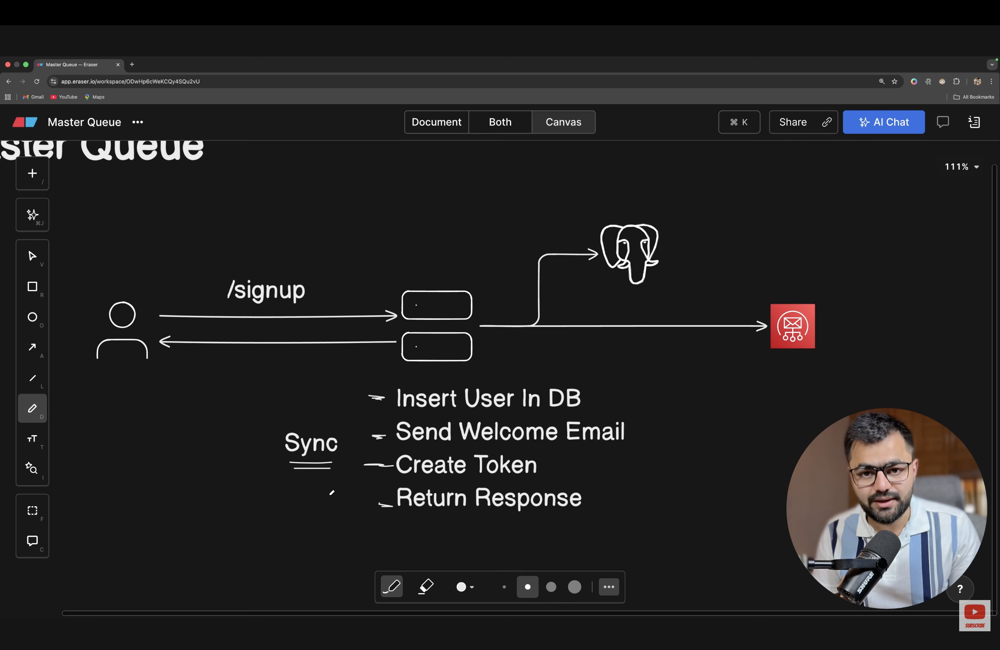
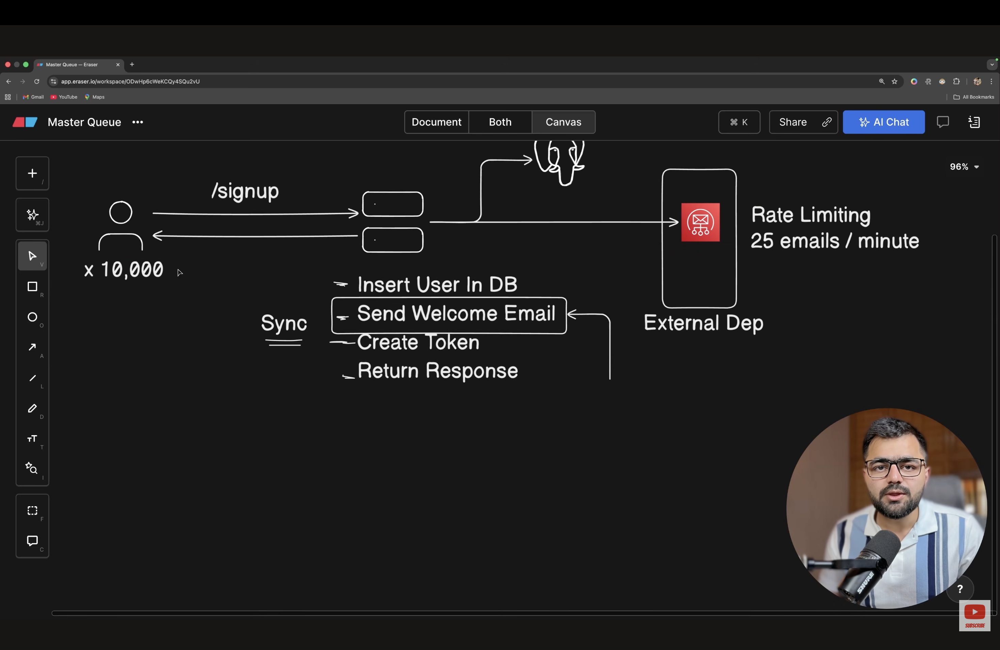
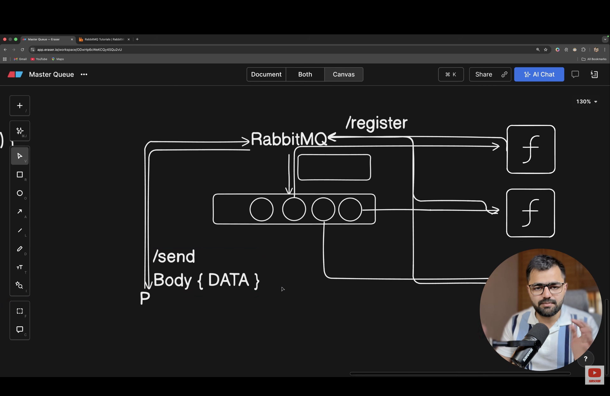

# What is Message Queue?
1. But before that we need to understand what sync and async programming.
- In sync programming  each instrcution in being executed in the sequence. Each instrcution waits for previous instruction to be finished before starting the exeuction of next instruction.
- For example let's say users sign ups - server check body
                                       - stores the data in db
                                       - send welcome email
- This sync approch will work only till users are low in number. once the users becomes large this approch will make system slow and email delivery become very slow.

- SO the Solution is async programming. In async programming the next instrcution doesn't wait for the complete execution of previous instrcution. Means it doesn't block the execution and the next instrcutions continue exeucting before the complete the execution of previous instrcution/task.  
- so design wil become like this. server can push user in queue and consumer/worker can pick the job and send the email using email service.

2. The queue is the data structure which follows the fifo approch. But if there are mulitple servers followingFIFO approch in muli worker apporch can make disprencies and to solve that we use KAFKA.
- In queue there 2 architecure 
1. Push architecure- In this the producer push the job in queue and the message broker pushes the job to the register worker to execute it.for eg RabbitMQ

2. Pull architecure- In this producer push the job and workers keep pulling/checking the message broker if there is job to do. In pull architecure we need to deel with defuplication. Exmaple aws SQS queue 
- BullMQ uses a pull-based approach from the worker's perspective

# What is a Message Queue?
- A message queue is a mechanism for temporarily storing messages or jobs so that producers can submit work and consumers can process it asynchronously.

- Components
1. Producer: Creates and publishes messages/jobs.
2. Message broker/queue: Accepts and stores messages until they are delivered or consumed according to its guarantees.
3. Consumer/worker: Receives messages and performs the required task.
