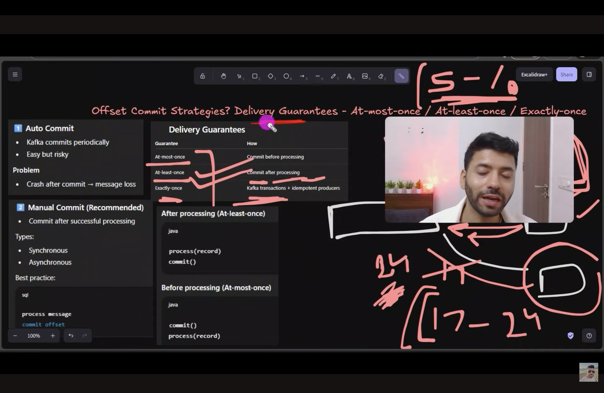
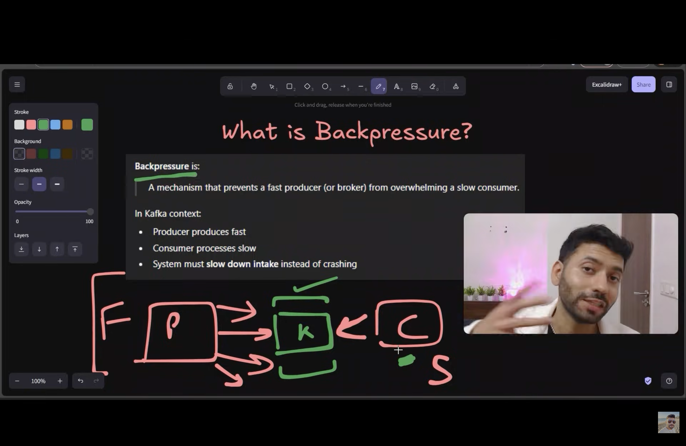
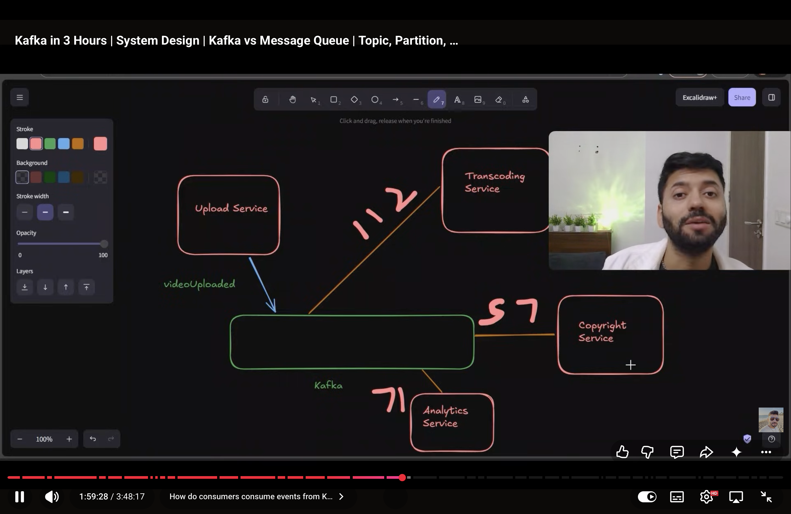
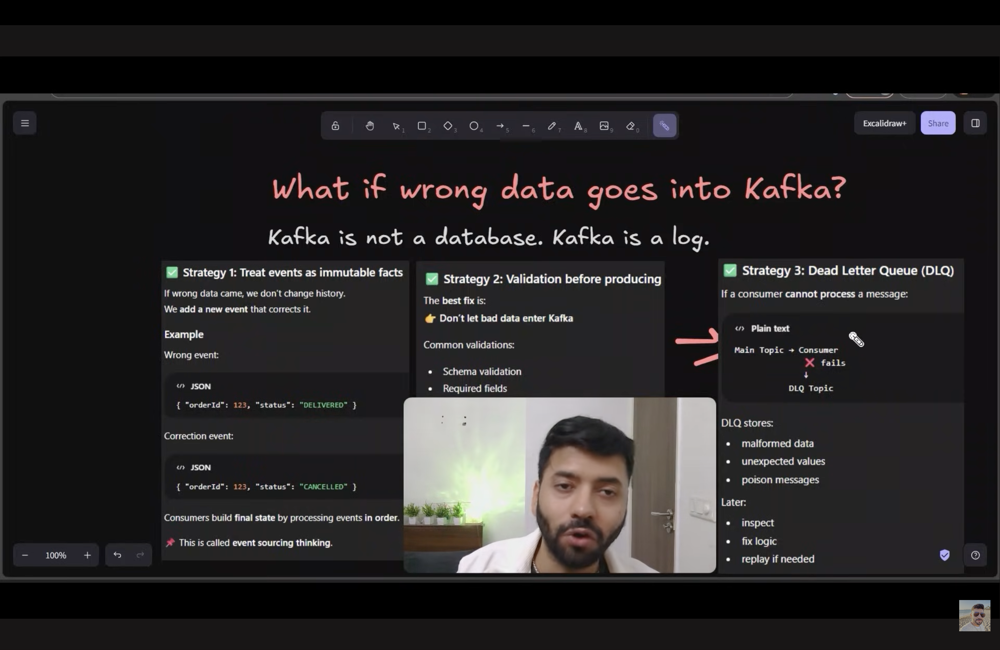
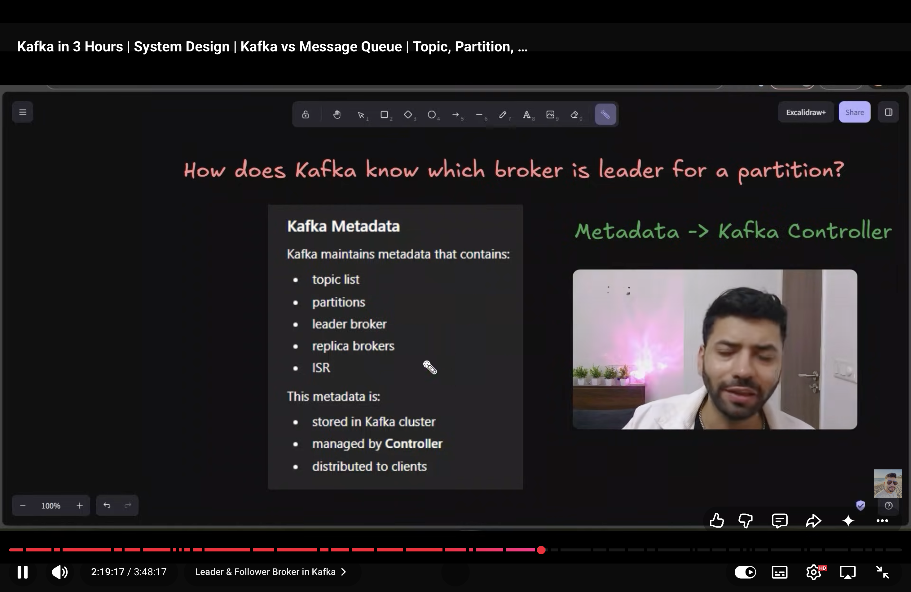
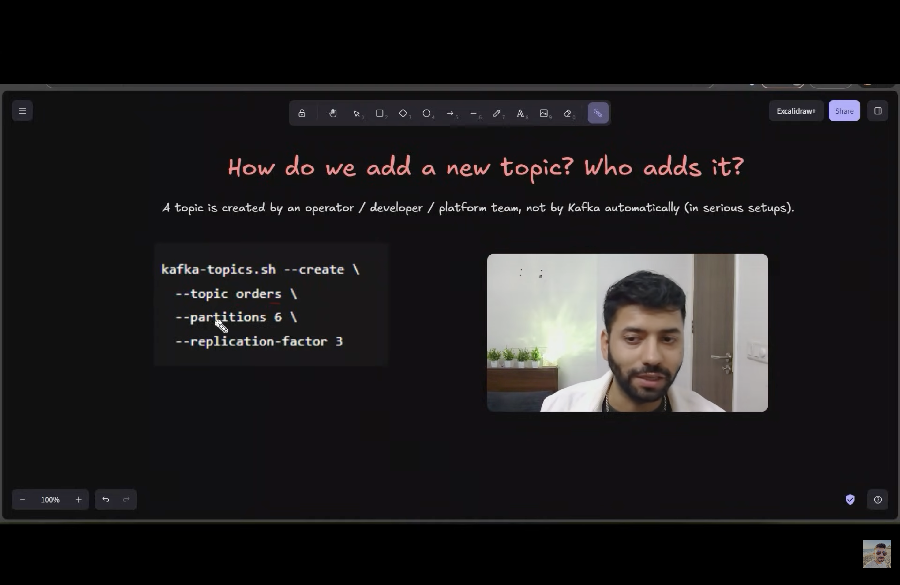

# What is Kafka?
- Kakfka is used as message/event stream.
- Apache Kafka is a distributed event-streaming platform. It stores events in topics, lets producers publish them, and lets consumers read and process them. Events can remain available for replay according to the topic's retention settings.
- Kafka has high throughput but lesser storage than DB. we use kafka becuase db throughput is very low and if we large number of operation per second on db the db can go down. So that'w why we use kafka to do large number of operaion per second.
- In kafka data can be consumed by multiple types of consumers and data is not deleted after consumed my consumer.
- The kafka have topic  where we push out data and topic data can be partitioned in to multiple partitions for parallelism. The one partition can be consumed by only one consumer where as one consumer can consume multiple partitons.
- for example there are 4 partitons and 2 consumer gorups first group have 4 consumers and 2nd consumer group have 2 consumers.The 2st consumer group with 4 consumers eill get 1 partition each and 2nd consumer with 2 consumers will get 2 partions each.
- If there are more consumers in comsumer group than partitions than that extra consumer will sit idle.
- The kafka does auto/self balancing for consumers and partitons.
- The topic is just logical name like folder name and partion is the physical location where data is stored like files.
- The consumer can produce the event too.
- The multiple consumers from different consumers groups each can consume the same partition at the same time.
- 
- 

# Kafka Internals
1. Producer: Publishes messages to Kafka. As for sending email, the producer can send {“email”, “message”} to the Kafka.
2. Consumer: Subscribes to Kafka topics and processes the feed of messages.
3. Broker: Kafka server that stores and manages the topics. In kafka there multiple brokers to prevent the single point of failure because kafka is distrbuted system. Combine all these brokers it is called cluster.
4. Kafka cluser -> It is group of multiple kakfa brokers.
5. Topic: A category/feed name to which records are published.
sendEmail can be a topic.
writeLocationToDB can be a topic.
Let’s take the analogy of a Database:
Broker = Database Server
Topics = Tables
6. Partition: Each topic is divided into partitions for parallelism.  It is the physical distirbution of data. Partition is similar to sharding in DB Tables. On what basis do we do partition? For that, we have to decide and code it ourselves.
Suppose, for our sendNotification topic, we partition it based on location. North Indian’s data goes to Partition 1, and South Indian’s data goes to Partition 2.
- Each partition is an ordered log, data is stored on disk. data is written sequentially.
7. Consumer Groups: When we make a consumer that subscribes to a topic, we have to assign a group to the consumer. Each consumer within a group does one type of processing from a subset of partitions.
Ex: For video processing, as we saw earlier, we can have two consumer groups. One consumer group is for video transcoding, and the other consumer group is for caption generating.
In short the consumer group is the group of same type consumers.

# Diff between kafka and message queue.
1. Data stays in kafka after consumer has consumed or process it where as in message queue the data is being deleted after comsumer consumed it.
2. In kafka multiple tupes of consumer can consume the event where as in message queue only one type of consumer can consume the job.

# What is offset?
- Offset is the monotonically increasing number which uniquely identifies the record in the parition.
- We need offset so consumers can track and resume there execution from right point.
- Offset is number identifying a record's position within a Kafka partition. Offsets increase as records are appended and allow consumers to track their reading progress. An offset is unique within a partition's log, not across the entire topic, and it is not a global event ID.

# Where are soffset stored??
- Offset is stored in kafka it'self. kafka has different topic for it to store offset.

# How consumers consume the data??
- The consumers group pull the data from kafka broker.
- Consumer uses polling.

# What if wronf data goes in kafka?
- Kafka is the log file not the database.
- In kafka we can peform only append operation ar the end of the file not update or delete operation.
- We can;t perform crud operation on Kafka.
- But how can we manage those events. the answer is we have retention period for example 28 days after retention period events are being removed from kakfa.

# Partiton replication.
- At the time of creating topic and partion we define the number of replicas we need.
- The replication of partition is needed to prevent the single point of failure and keep our system running.
- For partition we uses leader follower architecture. 
- In this kafka have number of brokers and one borker is leader where both read and write is happening and other replicas just keep the copy of leader broker by pulling the data from leader broker on continues intervals.
- When leader broker goes down one of the follower broker will become leader broker and keeps the kafka system running.
- 3 replicas is industry standard where one broker is leader and other brokers are replicas/follower.

# Kafka Full flow.
1. Producer connects to any kafka broker as for metadata from kafka cluster.
2. Gets the kafka metadata like topic, parititions, leader/follower brokers.
3. Producer needs to deicide to which parittion event should be stored.
4. Producer selects the parition like from key if it is present.
5. Producer fnds the lead broker for that parition  and send the data to that broker.
6. Leader broker stored that data.
7. Followers brokers replicate the data from leader broker.
8. Consuner get the metadata finds the leader brokers for that partiton and pull the data from that broker and maintan the offset.

# Kafka vs Pub/Sub
- The important distinction is that Kafka is a specific event-streaming platform, while Pub/Sub is a messaging pattern that many systems implement.
- When developers say "Pub/Sub" in a comparison with Kafka, they often mean a traditional broker-based Pub/Sub system.

| Feature | Traditional Pub/Sub (e.g., Redis Pub/Sub) | Kafka |
|---|---|---|
| Main purpose | Deliver messages to subscribers | Store and stream events |
| Message delivery | Often pushes messages to connected subscribers | Consumers typically fetch records |
| Message retention | May not retain messages | Retained according to topic policy |
| Offline consumers | May miss messages | Can catch up later |
| Replay old events | Usually unavailable in ephemeral Pub/Sub | Supported while records remain retained |
| Multiple independent consumers | Yes, depending on the system | Yes, via independent consumer groups |
| Consumer progress | Depends on the system | Tracked using offsets |
| Best fit | Real-time notifications and transient updates | Durable event processing, event replay, and multiple processing pipelines |

	

Durable event streams, replay, and multiple processing pipelines
# Cmd to create topic

# Docker cmd to run kafka.
docker run -d \
  --name kafka \
  --network kafka-net \
  -p 9092:9092 \
  -e KAFKA_NODE_ID=1 \
  -e KAFKA_PROCESS_ROLES=broker,controller \
  -e KAFKA_LISTENERS=PLAINTEXT://0.0.0.0:9092,CONTROLLER://0.0.0.0:9093 \
  -e KAFKA_ADVERTISED_LISTENERS=PLAINTEXT://localhost:9092 \
  -e KAFKA_CONTROLLER_LISTENER_NAMES=CONTROLLER \
  -e KAFKA_LISTENER_SECURITY_PROTOCOL_MAP=CONTROLLER:PLAINTEXT,PLAINTEXT:PLAINTEXT \
  -e KAFKA_CONTROLLER_QUORUM_VOTERS=1@localhost:9093 \
  -e KAFKA_OFFSETS_TOPIC_REPLICATION_FACTOR=1 \
  -e KAFKA_TRANSACTION_STATE_LOG_MIN_ISR=1 \
  -e KAFKA_TRANSACTION_STATE_LOG_REPLICATION_FACTOR=1 \
  -e KAFKA_GROUP_INITIAL_REBALANCE_DELAY_MS=0 \
  apache/kafka:latest