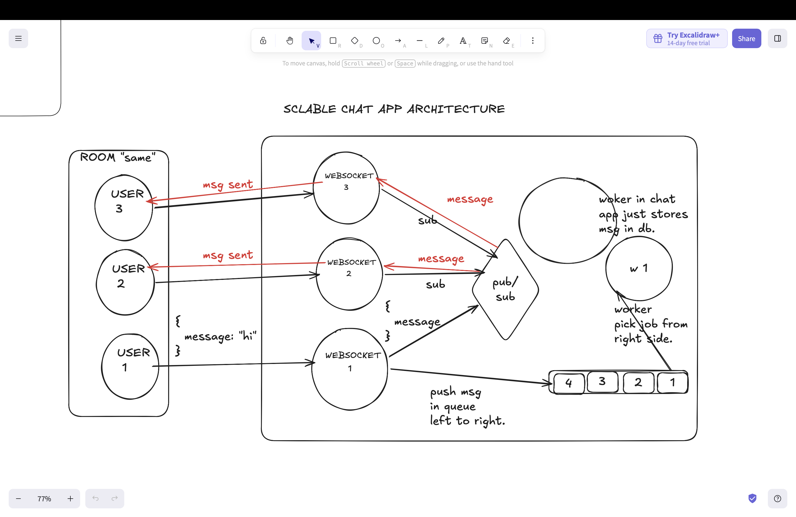

# What is PubSub?
- Pub sub is the publisher subscriber architecture. Pub/Sub is a messaging pattern used to distribute events.
- In Pub sub the producer publishes the message on pub sub broker for certain event. And the consumers subscribes to that event and pub sub broker automatically pushes those msgs to the consumers who are subscribed to the particular event.
- In pub sub the data is not saved once the msg in being pushed to consumers.
- And the pub sub broker automatically pushes the msgs to the  multiple types of consumers.
- Pub sub is very usefull in creating low latency system. For example if there are multiple websockets server and users are connected to different websocket servers and wants to send msgs to each other in this case users websockets server can subscibed to particular event and and get the msgs from pub sub broker and than those websockets can broadcast msg to users who are in that event.

