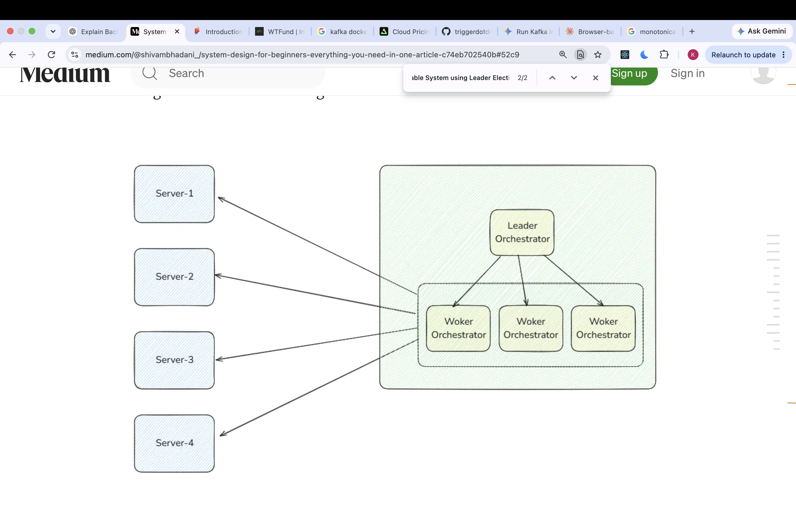

# What is Auto-Recoverable System using Leader Election?
- Suppose we have multiple server and using load balancer to route the requests to those servers.
- What if the some server goes down in order to restart the server we need to restart the server manually. In that case the solution is start the orechastrator nodes which will orechestrate server and restart the server automaitcally.
- But what if the orchestartor goes down for this the solution is to follow leader follower architecture where leader orechestrator checks and restart the other follower orchestrator and the orchestrator nodes keeps the check on server to restart the server the automatically.
And when leader orchestrator goes down leader Election algo takes place and one of follower node is promoted to leader orchesrator.
- Whenever any server goes down, the worker-orchestrator will restart it. When any of the worker-orchestrators goes down, the leader will restart it. When the leader-orchestrator goes down, then one of the worker-orchestrator will promote itself 

