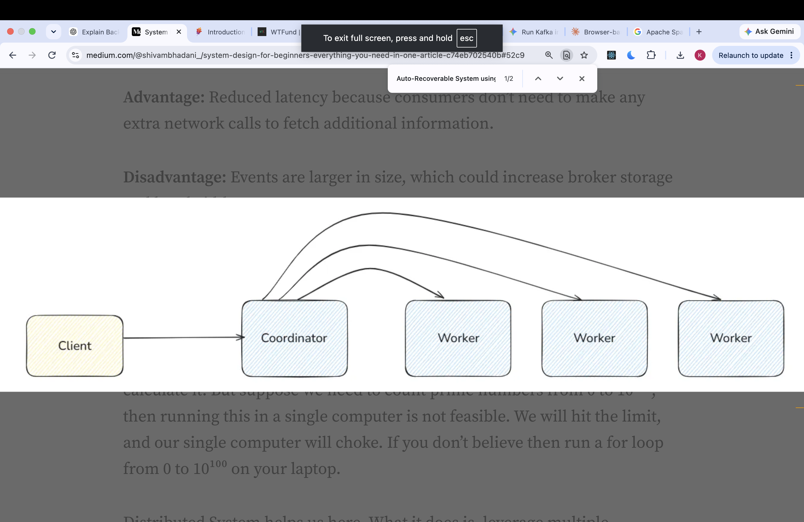

# What is Big data tool??
- A big data tool is used to store, process, move, or analyze datasets that are too large, too fast-moving, or too complex for traditional single-machine approaches to handle efficiently.
- For example, imagine a video platform collects:
100 million video views per day.
- The big data tool is used to process large amount of data when the single machine can't process the big data without hitting the machine threshold.
- The big data tool works on the corrdinator and workers architecture the client send the big data o the coordinator and coordinator divides that big data set into smallers data sets and issues the those small data sets to the workers. the workers process the data indvidually and each worker return the result back to the coordinator the coordinator stitch back the result in to one result and return back it to the client.
- It is very usefull in machine learning and when we want to collect data from differnt sources and dump data into data warehouse.
- 

# Understand it with a real example
- Suppose YouTube wants to calculate how many times each video was watched yesterday.
- The input data contains 1 billion view events:

video_1, user_10
video_2, user_12
video_1, user_15
video_3, user_20
video_2, user_10
...

- A single machine might take too long to process all these events. So we distribute the work.

- Step 1 — Split the input into partitions

1 billion view events
       |
       ├── Partition A → Worker 1
       ├── Partition B → Worker 2
       └── Partition C → Worker 3

- Step 2 — Workers process their own partitions

- Each worker counts views for each video in its partition.

Worker 1: video_1 = 500, video_2 = 300
Worker 2: video_1 = 400, video_2 = 200
Worker 3: video_1 = 100, video_2 = 500

- Step 3 — Aggregate the partial results

video_1 = 500 + 400 + 100 = 1,000 views
video_2 = 300 + 200 + 500 = 1,000 views

- The final result is written to a data store or returned to the requesting application.

- This is the core idea behind MapReduce: process pieces of data in parallel, then combine the intermediate results. Real systems often have additional stages for grouping, shuffling, sorting, and aggregating data.
