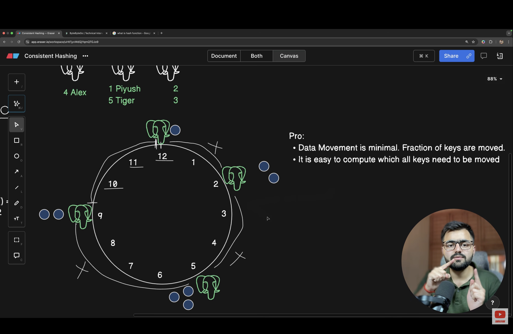

# What is consistent hashing?
- Consistent Hashing is just the hashing algorithm that tells which data belongs to which node.
- It is very important for statefull distrbuted systems like databases.
- Lets our app is having alot of data incoming and single db server can't handle it.
- We baught 3 db server and split the large dataset into smaller data set and host it on each db server.
- But the question is how do we determinstically distrbute the data over multiple db servers??
- The answer is hash function it is suitable for when we dont scale the number of servers further because if we change the number of server the keys position will change and we have to do large amount data movement.
- In hash function we take module of key % number of servers. And than store the data on the server according to that hash. But if server no changes keys position will change and we need to make large amount of data movement.
- The solution for hash function is consistent hashing in which we take the ip addresses of servers and hash it through the sha128 algo and map the server with that hash on clock from 0 to 128.
- And also hash the keys with sha128 and put the key on the db server which is closer to it clockwise.
- if we change the number of server than we just change those keys we comes between below new server index on clock.

- 