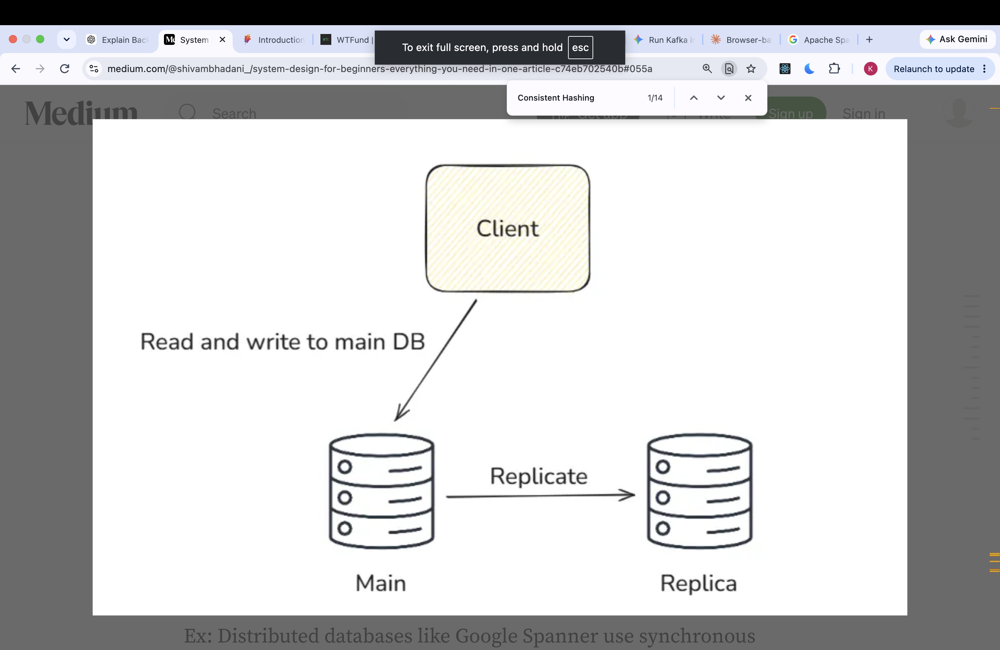

# WHat is Redundancy and recovery?
- Redundancy means maintaining copies of the same data on multiple machines.
- Most of the API servers are stateless so there is no need to maintain the redundancy. But db are statefull if if DB crashes permanently than we will lose the data. for this we need redundancy.
- Id DB disk crashes or any catstrophic sistuation occur than to prevent our app data we need redundancy.
- The best way for redundnacy is to maintain the main and replicas db servers. The main db  server is used to read and write and replicas db server is used to maintain the copy of data.
- The data is stored on replica sync or async and when the main db server crashes the replicas server takes it's place and our app keeps working as usual.

- 