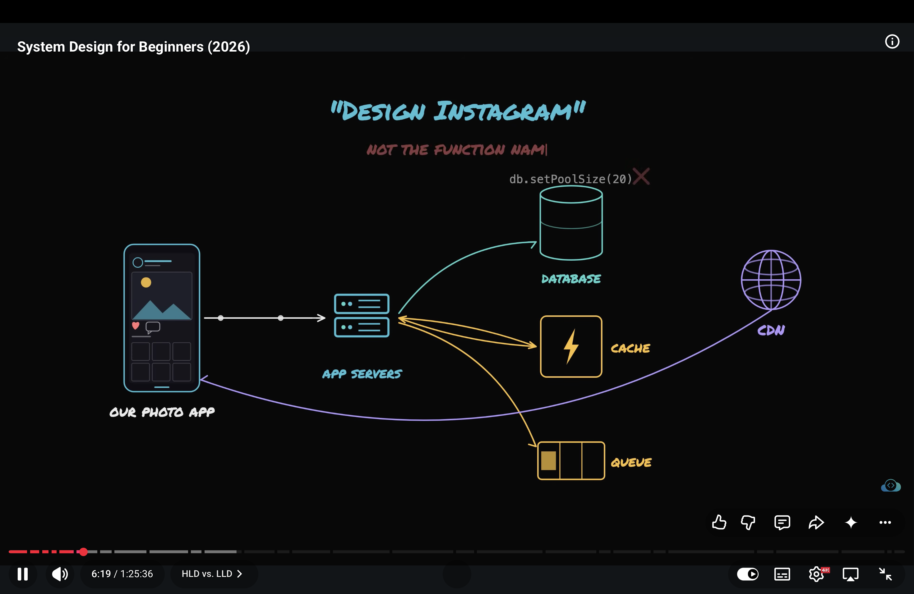
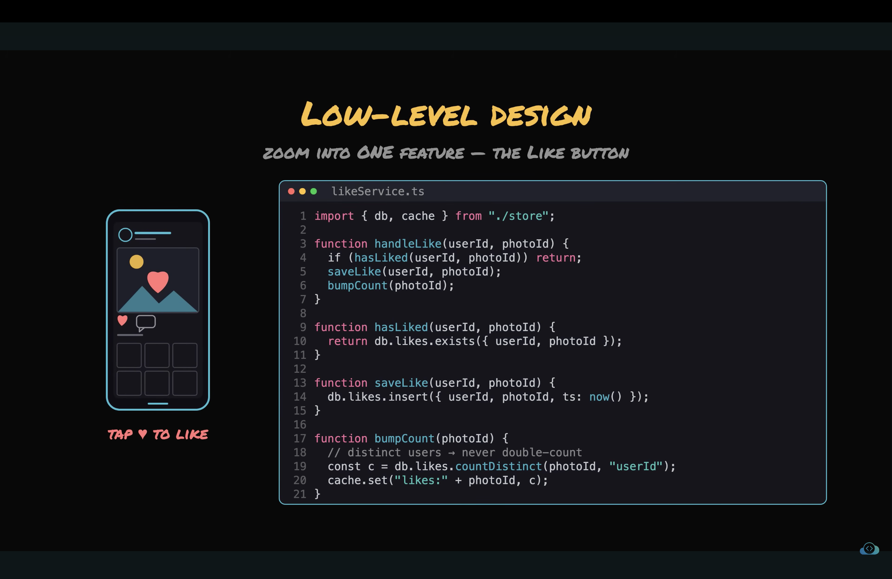

# What is HLD?
- HLD stands for High lever design.
- HLD Zooms out.
- HLD is concerned about the types of components we need and the architecture of whole application with different components and the flow of data among them.
- For example deisgn instagram
- 

# What is LLD?
- LLD Stands for Low level design.
- LLD Zooms in one feature.
- LLD is concerned about the how the each indvidual feature, componets or module works.
- The LLD output are class diagram, scheema, implementation logic.
- For example design like featuure, degign in memory cache. Interview wants to see how i organize code, objects and Data structures.
- 

# Interview Byte 1
# Interviewer asks design instagram.
- Always ask design HLD or LLD.
- IF HLD say i can zoom in indvidual components later if we want.
- IF he asks LLD than i should talk about classes, data strcutures no need to talk about servers.
- Always ask for the altitude at which i should answer, Cause mismatch altitude cause loose interview.