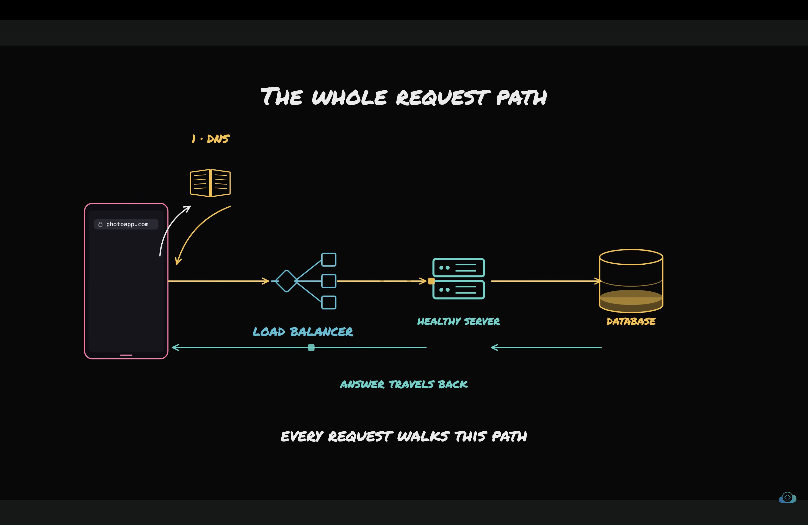

# Request response cycle.
1. The client types the address of our app in browser.
2. The browser goes to DNS with that domain name and DNS resolver resolves the human readable domain name in to numberical IP address.
3. The browser get back the IP address and finds the server which associated with that IP address on the internet.
4. Once it finds the server browser sends HTTPS req and server get's the req and route the req to correct process and process handle the req and return the HTTP resp back to the client.

1. Latency means how much total time one req takes to travel from client to server and resp to travel from server to client back. It is mostly denoted in ms. Latency should be low to create better system.

2. Bandwidth means how much data can be travelled between client and server per unit of time.
- Bandwidth is the maximum amount of data that can be transferred over a connection per unit of time.
- Usually measured in bits per second (bps), such as Mbps or Gbps.
- Higher bandwidth means more data can be transferred per second.
- It does not necessarily mean each individual request will finish faster.

3. Throughtput means number of req or unit of work, system can handle or process per second.

- 