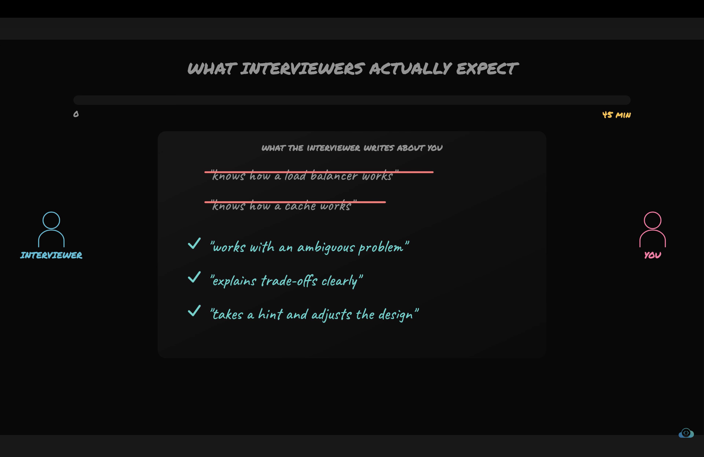
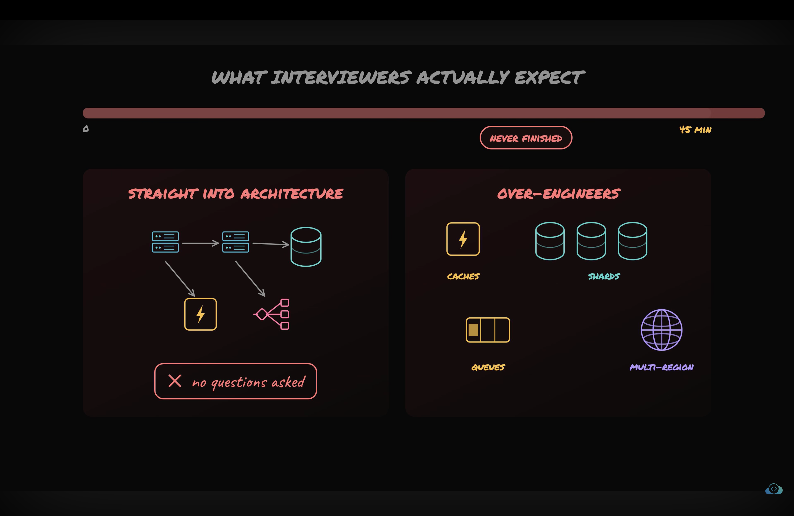

- 
- Things not to do in interview.
- 

# $ things interviwer actually wants.
1. Judgement under ambiguity. Means turning ambiguity in to concrete.  for example design insta -> photo + feeds

2. Technical depth: for example if i add cache here what problem in solves.

3. Communication with interviewer.clearly explain interviwer what am i doing and why am i doing.

4. Collaboration -> Ask question to interviewer