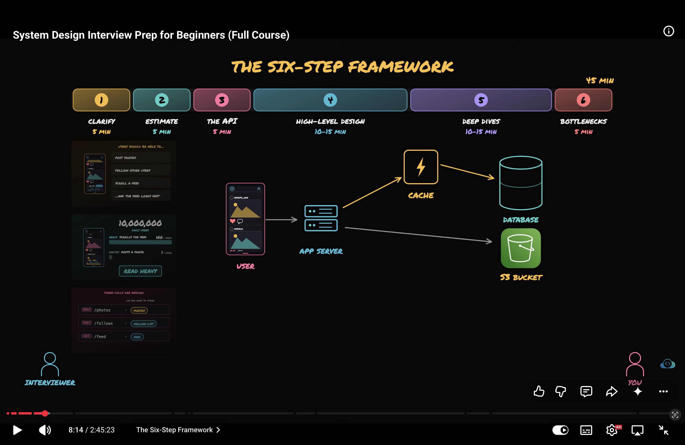

# But i think before anything i should ask what our app should do and those 5 ques.
# Six Step FrameWork.
1. Clarify: Ask the function and non-functional requirement like what users will ask our app to do and how well the app should do it?

2. Estimcate: Here we need to estimate the load and is app read or write heavy?

3. API: Finds what our app needs to do and create endpoint for it.

4. High level design: Here design HLD with different components.

5. Deep Dive: Deep dive on main workflow.

6. Bottleneck: Here figure out where load could become very large and optimize it.

- 

- For example lets say app have 10 million users and users read post frequently and not post frequently so it is read hevay system does that sounds readonable?
- I should i ask these types of ques to make ambigouty into concreate data.

# Design a ticketbooking system like ticketmaster.
1. Are we only booking tickets or organizers too? This question defined the scope of system.
2. How many people shows up on big events. -> this ques says the sacle of system.
3. When one users starts chek out for 1 seat than that seat become unavailable to all? -. says hardest compoenets.
4. Do users search on our app or users arrive with link for booking? Features.