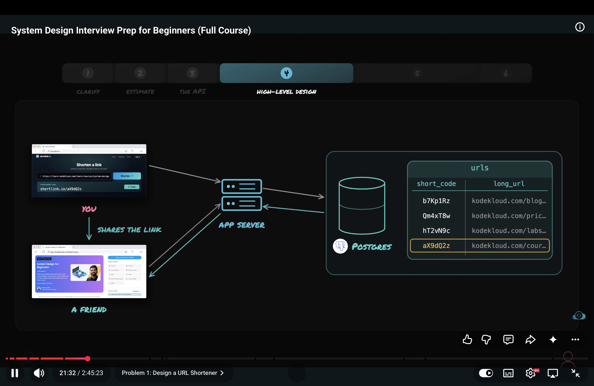
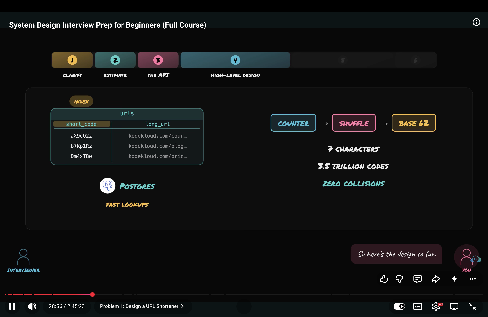
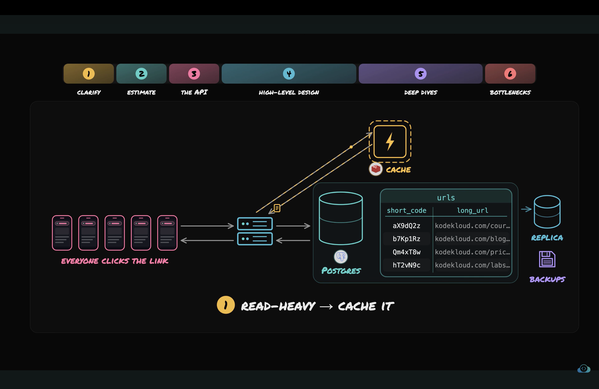
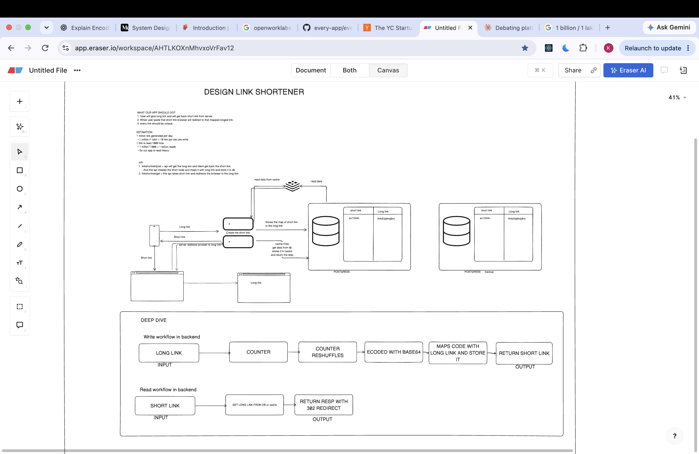

# Design URL Shortner.
- Lets apply 6 steps framework
1. CLARIFY - find functional and non funcitonal requirements.
  1. Users paste long link and will get back short link which when they paste on browser and browser will get redirected to  the long link.
  2. Can user pick there custom short links? like shortlink.io/instagram instead of shortlink.io/a2jbdcj22
  Allowing this means the custom short link is taken or not if taken than reserve it and it will make us change the system.
  3. The shorts links generated by our app will stays forever or expires after some time?
  4. Does our app needs analytics?

  # After asking these question i should have the notes.
  - No custom links
  - Link never expires
  - Analtics only if there is time

  # After getting ans for my ques i will repeat the scope of the system very clearly to the interviwer.
  - I need to create a short link that redirects to the original link.
  - we are not allowing the custom link.
  - There's no expiry date on links.
  - Analystics is good to have if we have spare time.

2. ESTIMATE:
- We can estimate load, storage, resoruce needs.
- But we should only estimate numbers what decides something.
- Ques 1 For example how mnay new links are generated every day?
- Let's assume 1 million per day
- 1 miilion/1lakh = 10 new links per second.
- Any DB can handle 100 writes per seconds so 10 is good to go.
- Ques 2 How many clicks each link can get?
- 1 miilion * 1000 clicks => 1 billion read 
- Which means our app is read heavy. Therefore we need optimize read compoenent.
- Ques 3 storeage estimation How many links we will store in DB.
- 1 miilion * 365 = 365 million rows

3. DEFINE API OF APP:
- 2 API calls are enough
- 1. POST/shorten takes long link and return short lnk to user
- 2. GET/redirect takes short link and redeirect to the long url.
- It is clear we need a table which maps the short code to the long url which is our whole data model.
- We should use NoSQL because data feeds are consistent for each row in table.

4. HIGH LEVEL DESIGN
- 
- Now I have to  say this one thing to the interviwer very clearly that this simple version already works. so now find the hard part.
- We said the server will take the long url and return the short url But how?
- We got 2 contraints code should be short and its should never repeats.
- option 1 Hashing
  - We take the long url pass it to hash function and pics the first 7 char for code.
  - The good thing with hash func is that if input is same the outpu will be the same 
  - But if input is diff the output will also be diff But the first 7 char can be same that's the problem.
  - So we need to check the DB to see Duplicate code.
  - SO the solution is add a char in input to change the code output.
  - Ans as our system grows collison will grow too and it will make the system slow.
- Option 2 Counting
  - we can keep the global counter which increase as the new link are generated.
  - than we can encode this number into base62 and store it in db with long url.
  - With base 64 we got 3.5 trillion code which are alot.
  - We can use Encoding but it has shortcoming and that is hacker can decode the base64 and finds the real counter and can add or substrat the 1 and get the short links which were never shared with them.
  - so the solution is to shuffle the number before encoding it for example counter give number like 789 we can implement fix secret rule like rearrange the digits and only than encode it.
  - And other weakness is that if 2 req arrive at same time than both req will read the same number and both will get same code.
  - So we need to make sure that counter stays correct even when multiple req from multiple users tries to access it.
  - BY using the lock system that only once req fetch and change counter. and counter will be only avaible when req one read the counter increment it and store new value.
  

5. DEEP DIVE:
- Now let's understand how read workflow will work. Because our app is read heavy.
- What celebrity shared our short link and million users are clicking on it? 
- On regualr days.
- Our app create 1 million links per day
- 1000 reads per links = 1 billion read per day
- rps = 1 billion/ 1 lakh = 10,000 read per sec
- 10,000 reads per sec on DB is alot 
- And we know the reault of query will always be same.
- And it can be fixed by cache redis in which we can store the results of query.
- But the cahcing come with weakness called staless in whcih the cache data is behind the db data. But in our system user is not changing the url shortners code so it match made heaven in for cache and link shortner.
- And we can store only hot keys in cache because cahe have less memory which means non frequently asked data is removed from cache.
- Also we can use CDN for HOT keys
- HOT KEY is the signature failure of any read haevy system in which massive number of read req comes per sec.

- Now Comes redirect part.
- Server can tell broswer to redirect to this long link.
- But how ther are 2 ways 301 or 302.
- 301 means this linkk moved to this link permanently. in this browser remembers the answer and next time when same user clicks on same link browser goes direct to the desitnation url wih asking our system. 
- 302 means go for there now but ask me again next time u access this link. it allows the every link req to flow from our req.

6. BOTTLENECK:
- Ask these 2 ques:
  1. what compoenet of system breaks first.
  - And what can we actually afford to lose for example cache fails the req can fall on the db.
  - The cache is perfomane layer not the actuall point of truth
  2. And what data can we never lose.
  - like mapping table
  - mapping table should have replica

# WHat if we want link to expire after some time?
- in this case we can add expire time in rows while creating row.
- and whenever read the link we can check if cross the expire time if yes than we can say url is expired

1. Encoding is the process of converting data from one format to another format. We can decode the encoded data to it's original form. 
For example Base 64  is a binary-to-text encoding scheme that turns binary data (like images, files, or raw bytes) into a plain-text string of safe ASCII characters.

2. Hashing is the process of converting any size of input into fixed sized of output.
It is one way we can't derive input from the hash output for example SHA-256