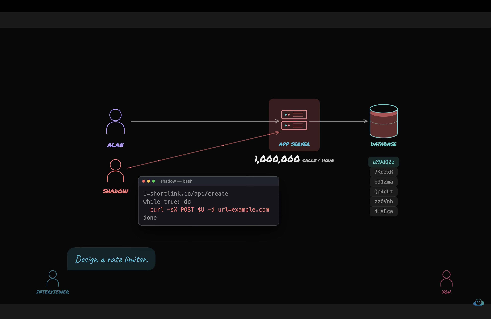
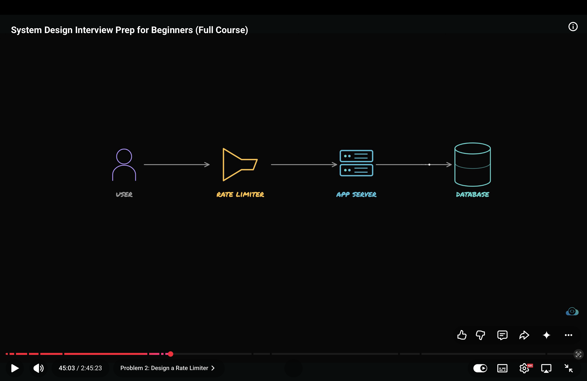
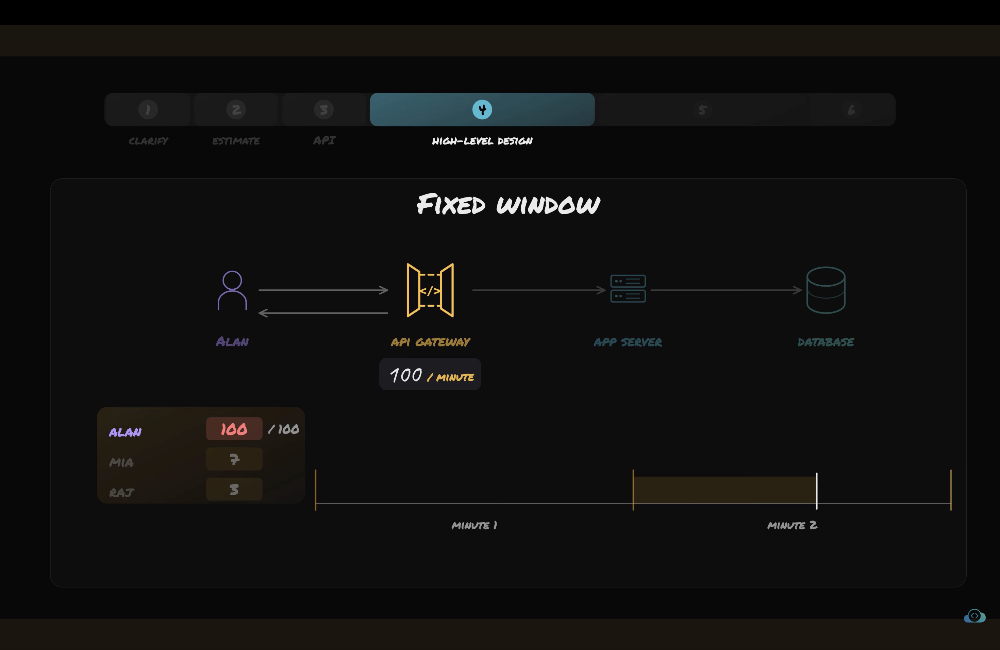

# What is Rate limiter?
- Rate limiter is the mechanism that controls how many req client can send to the server with in a specified period of time.
- In simple words it puts the limit on how frequently users can use the api.

- We need rate limiter because for example:
- In link shotener app we are exposing api to short the link.
- The hacker can create the script which sends 10,000 req in short time to overwhelm our system.
- Which make the system slow.
- Consumes the system resources like storage and processing.
- and makes the genuine users suffer.

- The rate limiter keeps the track of requests sent by client in a specified period of time.
- For example we want client to send 5 req per miniute not more than that.
- If user makes req more than upper limit than server needs to return the resp with code 429

# Let's build it with 6 step framework.

1. CLARIFY:
- Ques-1. How do we identify who is making api call?
        - first way is using which acount is making the req.
        - second which IP is making req.
        - is track which api key the req is carry?

        - if we use IP address then one office with 100s user share single IP address.
        -  And hacker can change there IP address to make the attack.

        - if we use API than only devs can use it. Normal apps users will not be able use it.

        - If we count number of req per account than we can't do anything for anyone who isn't loged in yet.

        - Let's say interviwer tells for loged in user we need to track no of req per account and for no log in users we need to count no of req per IP address.
        log in users - track req per acc
        no log in user - track req per ip address

- Ques-2: What is the limit of req for each user?
        -  let's say 100 per minute per user.
        - How i get to this number? use traffic as the base of these number.

- Ques-3: What should happen if client crosses this limit?
        - reject the req with code 429 and tell user to send req after this much sec. with clear msg.

2. ESTIMATE: 
storage :
- Let's say the count -> time = 50 Bytes
- 50 * 10 million users = 500 MB of storage

- API call rate
- 10 million user * 100 req a day = 1 billion req
- 1 billion /1 lakh = 10,000 req per sec
- in busy time * 3 time = 30,000 req per sec on busy time

3. API
- Rate limiter only needs to check if the req is allowed or not?
- if nor return the resp with 429 code and with small note to retry after these seconds.

- where it should sit?
- it should be between server and client.
- for example in api gateway
- it sits in the request path between the client and the protected resource.

4. HLD
- 