# What is Notification system?
- Notification system is the mechanism which notify the correct user through single or multiple channels when any event occures in the system.

1. CLARIFY:
- Ques-1. What are these notifications for?
          1. Transational notification like payment goes thrpugh or login code.
          2. Marketing notification like sales ongoing.
          Interviwer says system needs to send both kind of notifications.
- Ques-2. Through Which channels system needs to send notifications.
          - 4 types of notifications are needed sms, push, email and in app.
- Ques-3. DO both txs needs to be reach user equally fast?
          - Txs notification needs to be fast.
          - Where as Marketing tx can takes some time.
- Ques-4. Can we loose notification and send notification twice.
          - sending twice is worse but loosing one is bad.
- Ques-5 DO users get notificaiton preferences?
         - Yes user can choose if they want notifcation or opt out.

- Functional req:
- One Event in
- Delvers through 4 chaneels.
- Respect user prefernces.

- Non Fun re:
- Small delay is ok.
- Try not to loose notifiction.
- And ideally shouldn't send notifcation twice.

2. Back of the Envelope Estimations.
- How many notfification per day?
- 10 million oer day.
- 10 million/ 1lakh = 100 notification per sec

3. API
- We need single api call using which other services can post the notifcation.
- POST/notfiy
- When somthing happens the caller should call notify api with data such as who to notify, the message and which channels.
- The caller can be any server like refund service, order service etc.
- And the notify service takes the notification andstores it in db with unique id and immediately return accepted.
- The actual nofication sedning is done later.
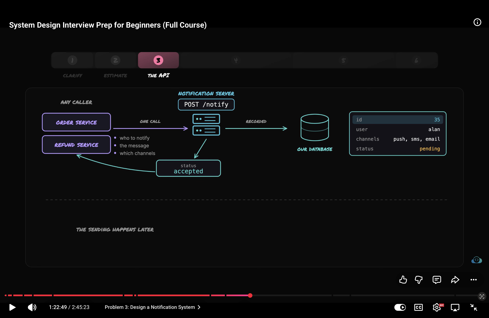
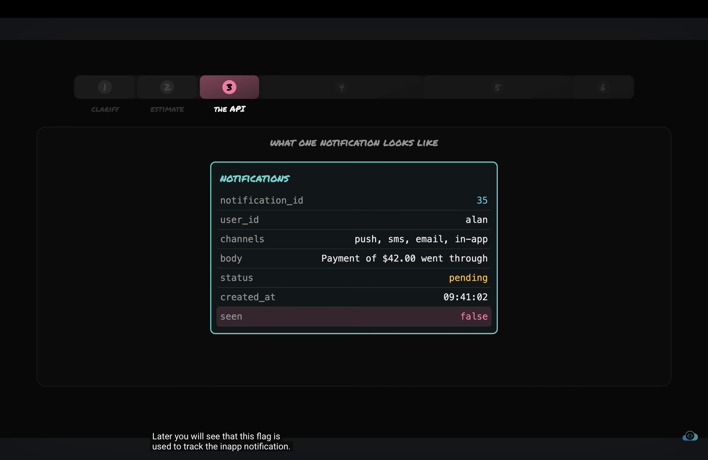

4. HLD
- Till now the services like payment service or order service will call our notification service.
- The notifcation service will take the notification store it in db.
- If we choose the sync coding it will make the operation slow and much more prone to failure if load increases.
- That's why we need async programming where the flow doesn't get blocked.
- Using Queue in Queue we will push only notification id.
- The worker will take the job id from queue and query db for the whole notification meta data.
- And than worker will call the external service to send the notification.
- Once worker get's confirmation from the external providers, worker acknowledges the job and remove it from the queue.
- The notify server does 2 writes once in db and another in queue
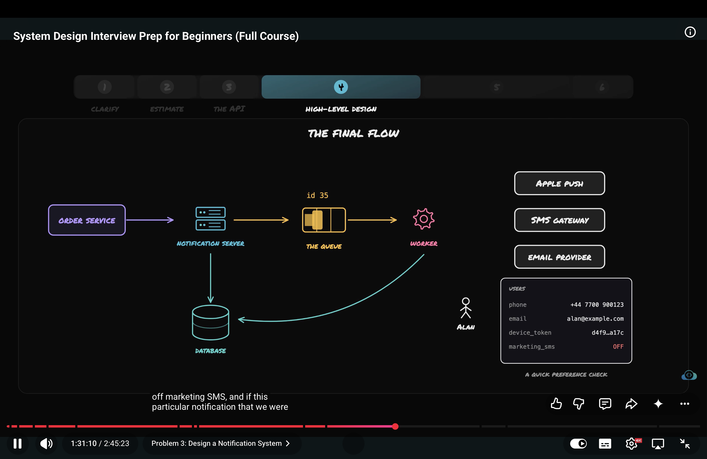

- Ques - what kind of queue do you want?
- Durable - queue shhould store the job in disk not on ram.
- Acknowledgement - the job should only be removed from queue if it is acknowledged by the worker.
- And queue should be able to work with multiple workers.

- We are doing async processing of notifications.

- Ques- Should all 4 channels share one single queue?
- No we need one quque for each channel.
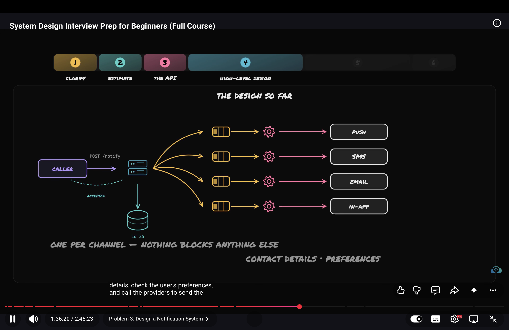

- How in app notifcation work?
- It is the easiest the worker just have to falg notifcation send.
- And when user opens the app the app will ask for unseen notifcation.
- All unseen notifcation will show.
- Once user see the notifications the app tell server to flag notification as seen.
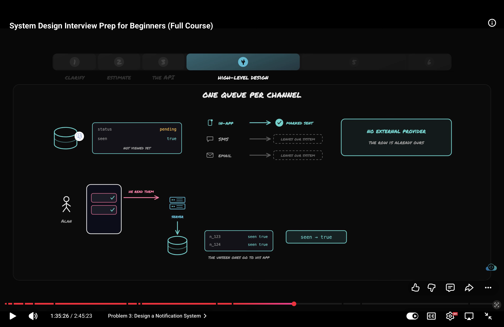

- Copying one event in multiple queue is called fan out.
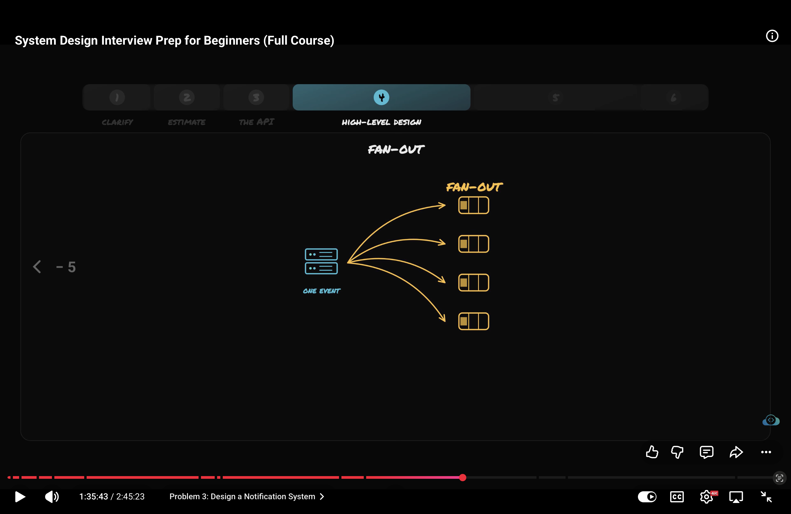

5 Deep Dive:
- Ques - What should worker do if external provider doesn't give any response?
- Typical answer is worker should retry.
- Ques But how many times worker should retry?
- Retry poilterly like wait 1 sec before 1st retry if it fails wait 2 sec for 2nd retry, wait 4 sec for 3rd req means double waiting time beofre trying again.
- Let's say worker didn't got any resp from multiple req than we will push that job to the dead letter queue.
- Dead letter quueue is for failed msgs.
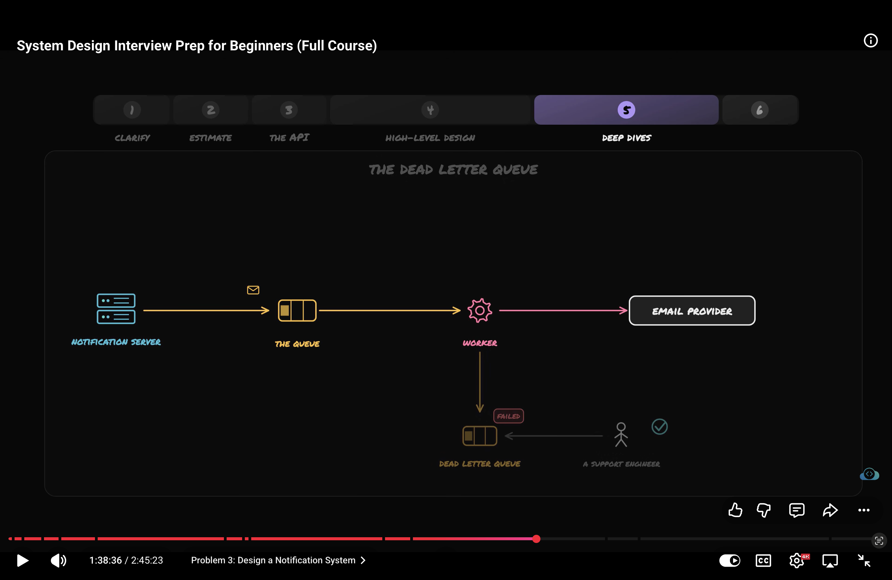

- The Duplicate trap.
- 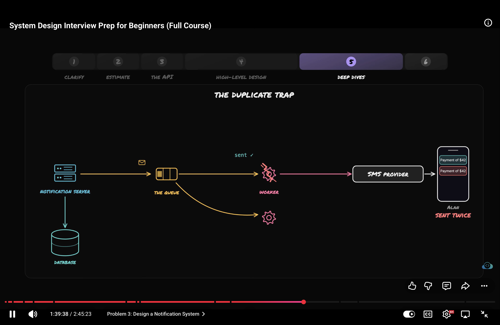
- Let's understand it the worker read the job from queue and reads the notifcation from db for that job id and worker send the sms notification.
- But before the woeker could do the acknowledgement the worker crashes.
- Now queue doesn't get the acknowledgment and the job is still in the queue.
- Queue give that same job to the other running worker and worker send the sms notification again.
- The user got notification twice which is the huge problem.
- How to solve this?
- SOl First we accept the fact that queue can some time pricess the job twice.
- We build the mechanism which identifies the duplicate drop it.
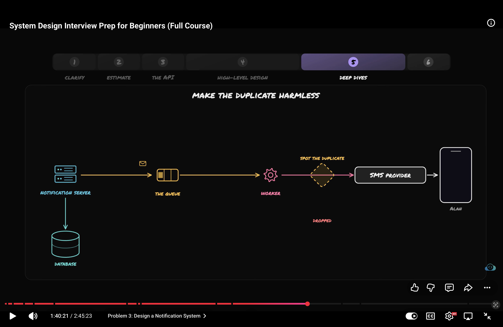
- Each notification has id that we store in db before calling any provider the worker check the shared storage.
- If the shared storage have the id than worker silently drops the job.
- If id is not in shared storage than first woker writes the note in shared storage that this job is taken and onlt after work calls the provider.
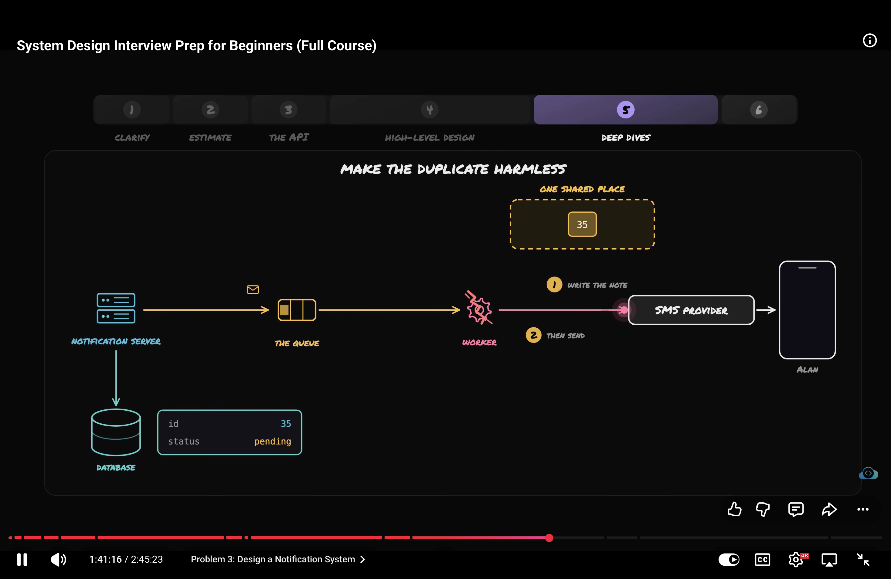
- But what if worker crashes just after writing the note on shared storage.
- Than the user will never get notification.
- SO for that note have expiry time after one min woker can pic the job and send it if it is not sent.
- Note is called idempotency key in our case this key is notification key.
- idempotency key means no matter how many time something is done the resolut is the same.
- Important
1. If the wroker get no resp from provider than wokere removes the job id from shared storage.
And retries the req.
2. Once the sent succed the worker change the notification status from pending to sent.
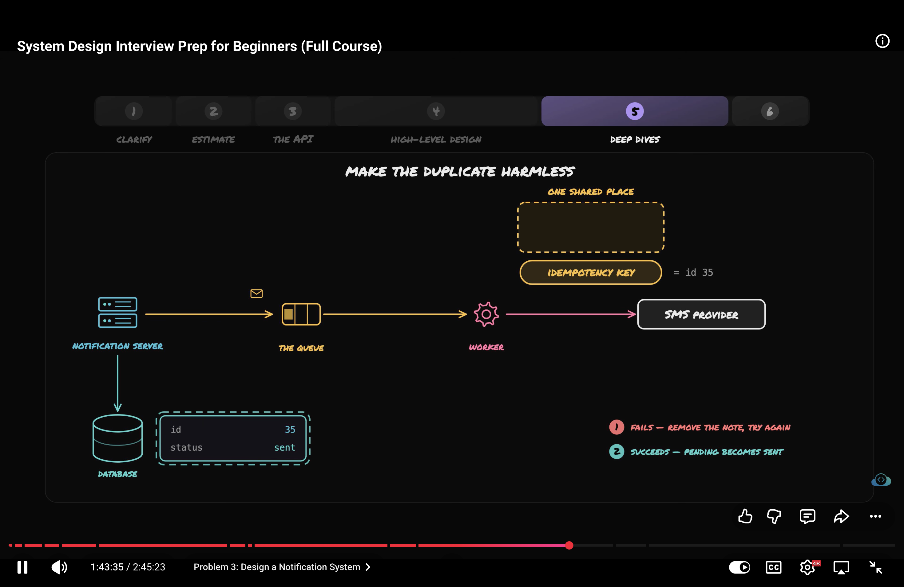

- Our notify service is doing 2 write n db and queue.
- What our notify server crashes after writing it in to db than the notification is in db but not in queue.
- At the end there is only one source of truth and that is db.
- so slution is first we only store notifcation in db.
And than runs a backer worker whose job is to check what notification are not sent. and push it in the queue.
- If the backer worker pushes the job twice in the queue than that's not the problem because our is keeping chek of dups.
- By using the note.
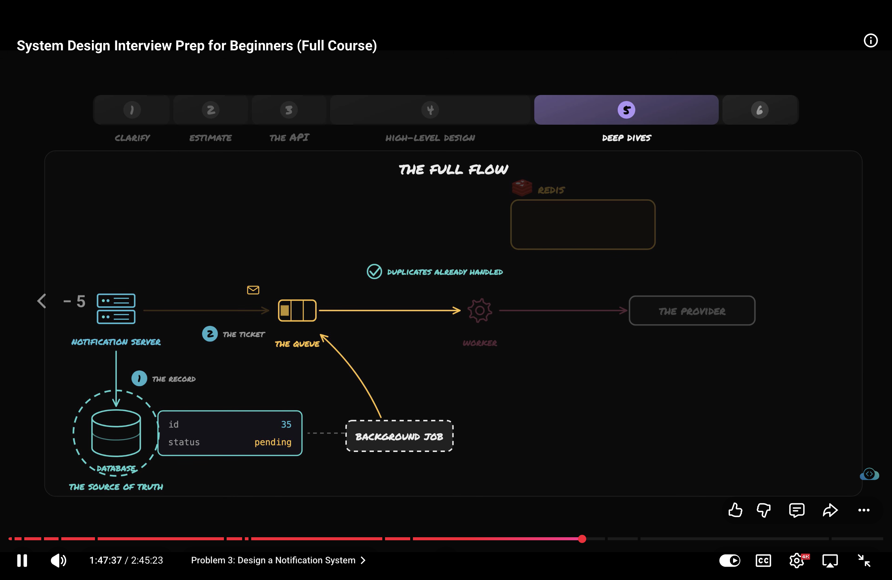

6. BottleNeck
- We can use aws sqs for queue.
- Add more worker if queue is getting large.
- We chose at least once delivery.