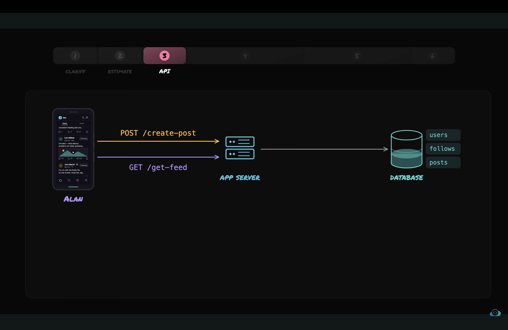
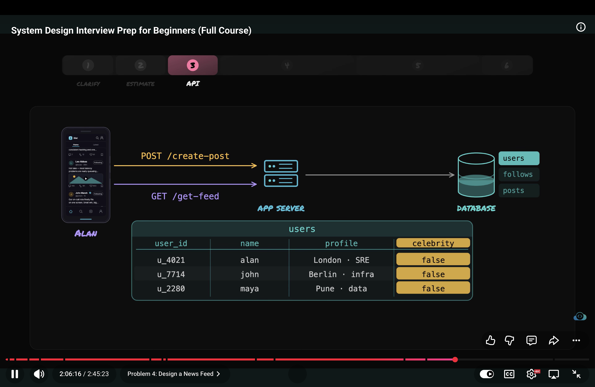
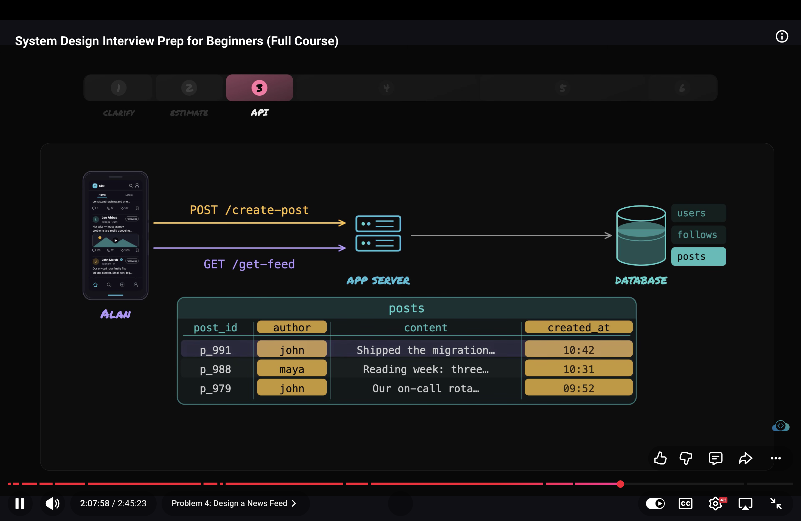
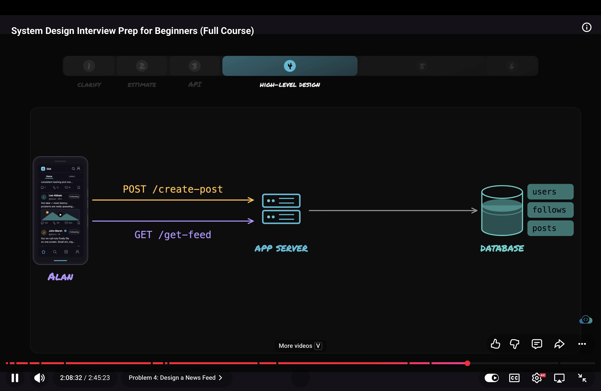
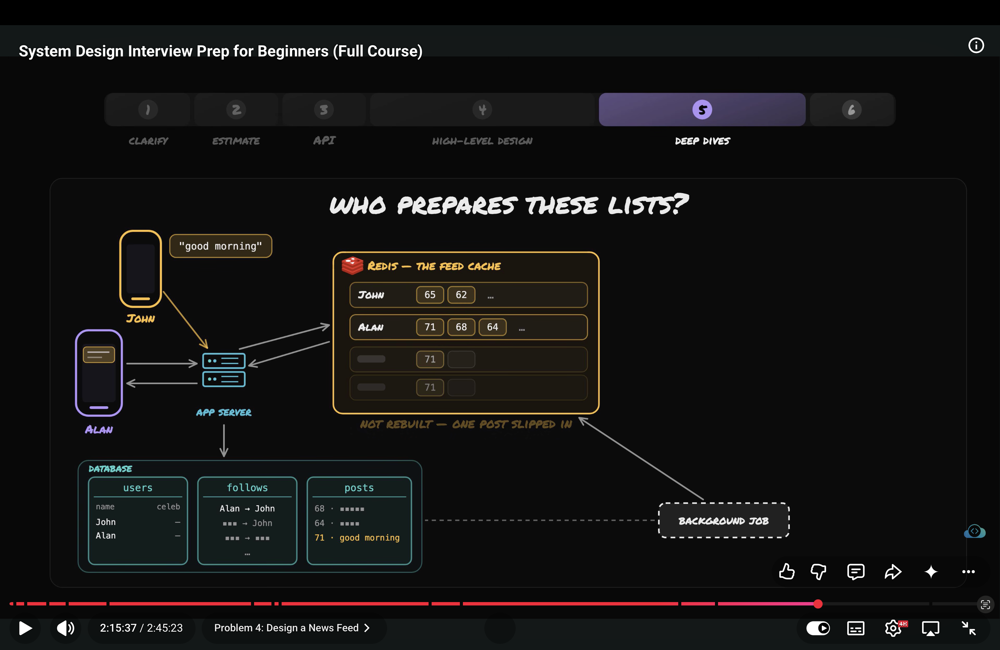
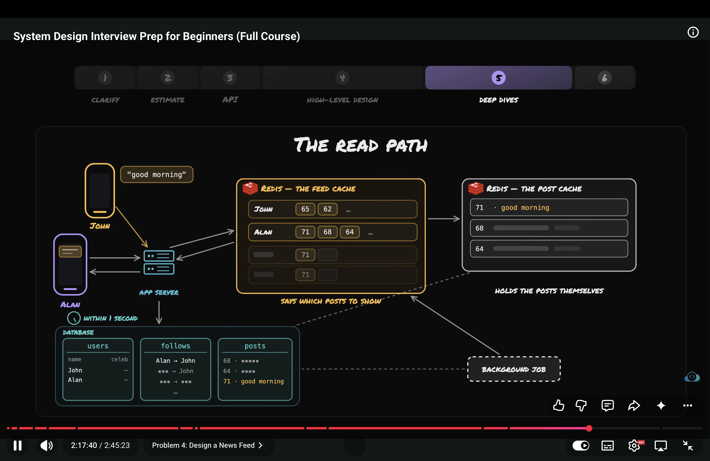
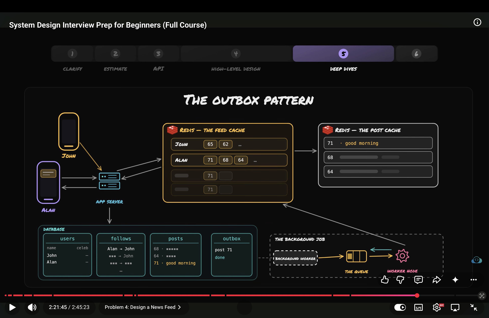
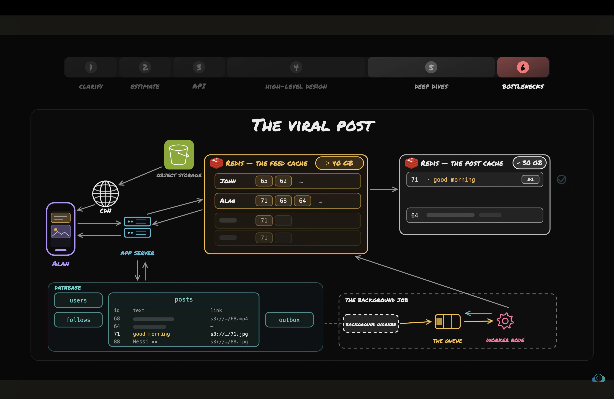

# What is NewsFeed?
- It is a general term which is used for any social media feed. Where user can sroll endless number of posts.
- For example linkedin , X where we scroll items posted by people.

1. CLARIFY: Get functional and non-fun req by asking min ques.
- Ques-1. What exaclty goes in to th feed, and in what order?
         - Feed should only have post from people the user follow and the new post should show first.
- Ques-2 How fast should a new post reach a follower? 
         - few seconds is fine but not minutes.   
- Ques-3 And how fast should the feed should load. what is the feed latency?
        - with in one second.
- Ques-4 Is the feed text only or images and video too?
        - imgs and videos are both supported along with text.
- Ques-5 What if the some post shows up twice?
        - The same post showing twice is not a proble, dupilcate post is acceptible.

- NewsFeed users can follow other accounts, users can create text, img and video posts.
- And users can read feed.
- In feed we show new posts of people followed by user.
- The feed should load within a second.
- And new post can take few second to user feed.
- And when user refreshes the feed duplicate post is acceptible.

2. ESTIMATION.
- Quest-1. How many users are we serving?
- 10 million daily active users.
- 10 million users * open the feed 5 times a day = 50 million feed reads per day.
- 50 million / 1 lakh = 500 feed req per sec
- 10 million user * posts 3 times a month = 30 million post per month. 1 million wrtie per day = 10 write req per sec.
- news feed is read heavy.

3. API + TABLE
- POST/create-post -> this api will allow users to create the posts.
- GET/get-feed -> This api allows users to read the posts. this api will return 50 sorted posts.
- There will be more api like follow, lie, comment. but for now we are not concern about them.

- What exaclty we store in db?
- Users, follows, posts.
- user table 

- Follows table stores the map of follower and followee
- 

- Posts table stores all the posts. with content, authorm and create at.

4. HLD

- How does users get his feed?
1. Allen open the app.
2. App sends the req to GET/get-feed api.
3. Server req the db to get all the followies of allen. let's say followies are 300.
4. Server than req all the recent posts of those followies and sorts them and send first 50 back to allen.
5. This is basic approch.

- There are multiple prpblem in this approch.

- 50,000 to 100,000 simple read queries per second for db.
- But in our system we are doing 9 lakh read per sec.

# In current apporch every feed is rebuilt from sratch. Is there any way we don't have to?
- We shouldn't build the feed when allen reads it. 
- Therefore we should have feed built before allen access it and we should store that pre built feed somewhere.
- And if sombody posts something new than we will go to allen feed and we will just  add that post in allen feed.

- We will store prebuilt feeds in redis.
- In redis we store feed in list.
- Each list holds only post id. Not actual post content.
- Means when allen open feed we still fetch the post content.

5. DEEP DIVES

- Let's understand with full workflow.
1. John creates the new post "good morning".
2. John post is stored in Posts table.
3. Now the background worker will read who are the followers of the john let's say there are 500 followers of john.
4. Then background worker will prepend the john post to all the john followers feed list in redis.
5. That's how feed is pre built.
6. Now if alice open the feed GET/get-feed server will get the feed list from redis directly.
7. Redis feed list for each user only stores the post id not actual post content.
8. SO for that we create post cache.
9. Post cache holds the actual post content per post id.
10. Now when john open the feed, the server reads john feed list and than read the post content from post cache for each post id.

# Inside backgorund worker.
- What is the Outbox Pattern?
The Outbox Pattern solves the Dual Write Problem.

The Dual Write Problem occurs when an application needs to write data into two independent systems, such as PostgreSQL and Kafka. We cannot guarantee that both writes will succeed or fail together.

To solve this problem, we use the Outbox Pattern.

In this pattern:
1. We save the business data in the database.
2. We also save the corresponding event in a separate Outbox table.
3. Both writes happen inside the same database transaction, ensuring atomicity.
4. A background worker (Outbox Relay) polls the Outbox table for unpublished events.
5. The worker publishes these events to a message broker such as Kafka or redis.
6. After successful publishing, the worker marks the event as published.

This ensures that even if the message broker is unavailable, the event remains safely stored in the database and can be published later.

1. In our case john create new post.
2. John post is stored in db post table and outbox table with note in a single tx for atomcity.
3. Background worker polls the outbox table for new job and push it in to queue.
4. Than worker asks for all the followers of john and take the john post from queue and appends it in to the feed list of all the john followers.

# Problem with precomputing approch.
- What if any celebrity with 100 million followers createa a post.
- Than in that case we need to update the feed list of 100 million users.
- To prevent this we need to tag users wh have more than 100k followers as celebtity to not do the lakhs of writes in worker.
- so now when alice opens it feed server will fetch the prebuilt feed from cache and also fetch the celebrities followed by alice from db. and than fetch there lastest post and return first 50 to alice.
- So now server is nor creating the full feed when user open feed but only for small number of celebrity followee.

- Feed built when user reads -> Fan-out on read
- Feed buit when the post is written -> Fan-out on write

6. Bottleneck
- Where will this design fail?
- We have 2 caches Post id cache and Post cache.
- We store img and videos in s3 and stores only there link in db
