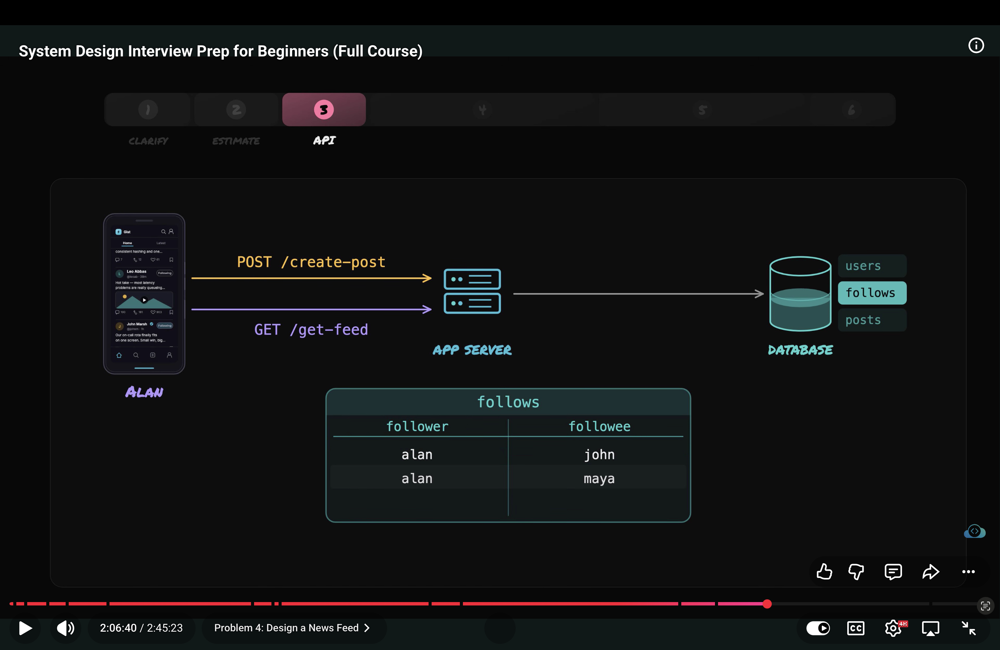
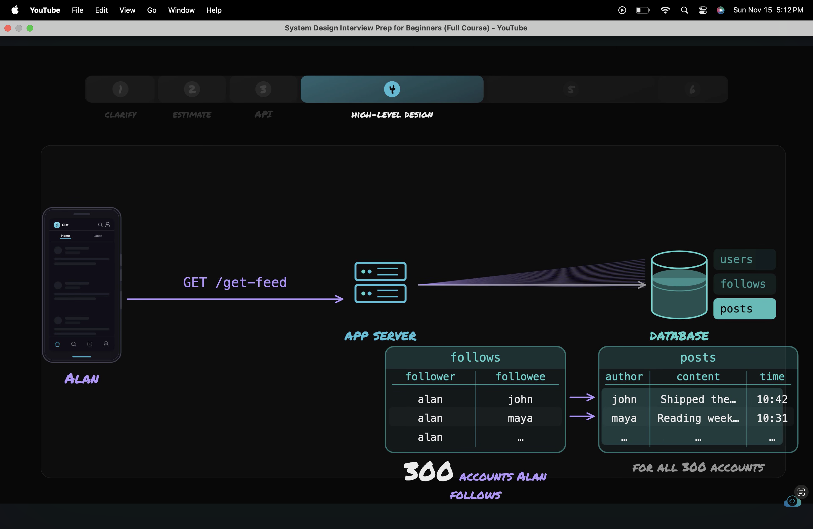
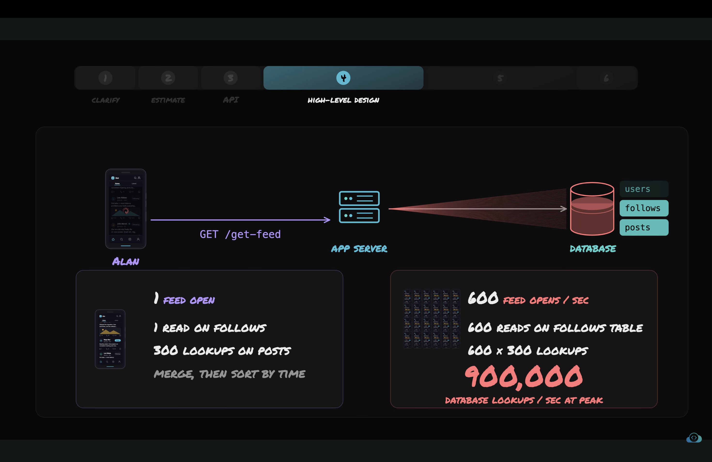
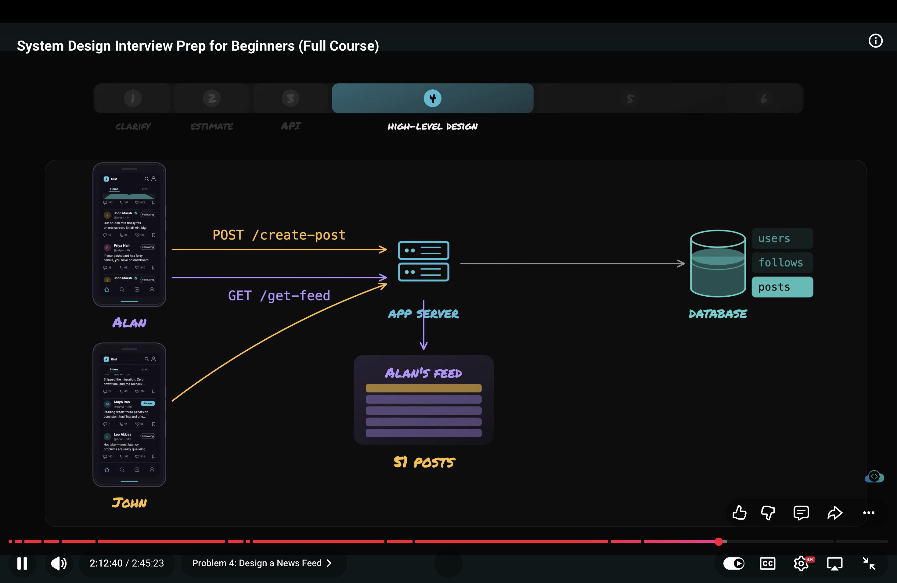

# What is NewsFeed?
- It is a general term which is used for any socal media feed. Where user can sroll endless number of posts.
- For example linkedin , X where we scroll items posted by people.

1. CLARIFY: Get functional and non-fun req by asking min ques.
- Ques-1. What exaclty goes in to th feed, and in what order?
         - Feed should only have post from people we follow and the new post should show first.
- Ques-2 How fast should a new post reach a follower? 
         - few seconds is fine but not minutes.   
- Ques-3 And how fast should the feed should load. what is the feed latency?
        - with in one second.
- Ques-4 Is the feed text only or images and video too?
        - imgs and videos are both supported along with text.
- Ques-5 What if the some post shows up twice?
        - The same post showing twice is not a proble, dupilcate post is acceptible.

- NewsFeed users can follow other accounts, users can create text, img and video posts.
- And users can read feed.
- In feed we show new posts of people followed by user.
- The feed should load within a second.
- And new post can take few second to user feed.
- And when user refreshes the feed duplicate post is acceptible.

2. ESTIMATION.
- Quest-1. How many users are we serving?
- 10 million daily active users.
- 10 million users * open the feed 5 times a day = 50 million feed reads per day.
- 50 million / 1 lakh = 500 feed req per sec
- 10 million user * posts 3 times a month = 30 million post per month. 1 million wrtie per day = 10 write req per sec.
- news feed is read heavy.

3. API + TABLE
- POST/create-post -> this api will allow users to create the posts.
- GET/get-feed -> This api allows users to read the posts. this api will return 50 sorted posts.
- There will be more api like follow, lie, comment. but for now we are not concern about them.

- What exaclty we store in db?
- Users, follows, posts.
- user table 

- Follows table stores the map of follower and followee
- 

- Posts table stores all the posts. with content, authorm and create at.

4. HLD

- How does users get his feed?
1. Allen open the app.
2. App sends the req to GET/get-feed api.
3. Server req the db to get all the followies of allen. let's say followies are 300.
4. Server than req all the recent posts of those followies and sorts them and send first 50 back to allen.
5. This is basic approch.

- There are multiple prpblem in this approch.

- 50,000 to 100,000 simple read queries per second for db.
- But in our system we are doing 9 lakh read per sec.
# In current apporch every feed is rebuilt from sratch. Is there any way we don't have to?
- We shouldn't build the feed when allen reads it. 
- Therefore we should have feed built before allen access it and we should store that pre built feed somewhere.
- And if sombody posts something new than we will go to allen feed and we will just that post in allen feed.

- We will store prebuilt feeds in redis.
- In redis we store feed in list.
- Each list holds only post id. Not actual post content.
- Means when allen open feed we still fetch the post content.