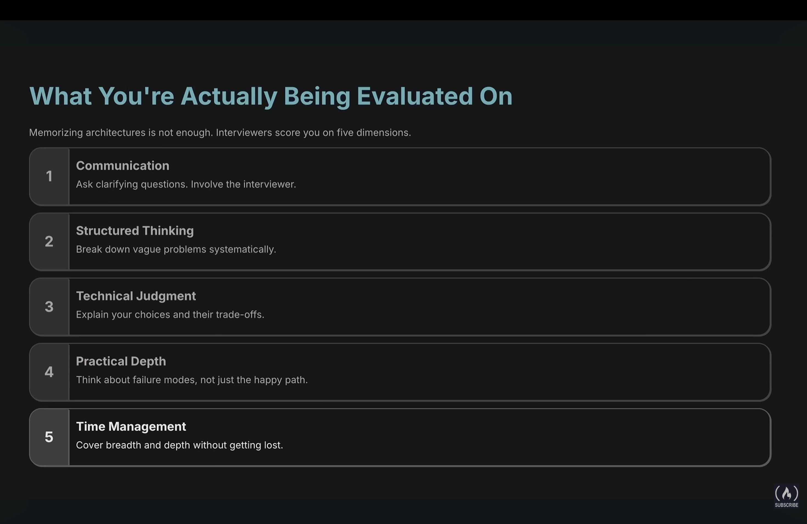

1. 
2.  
- My main job is to turn vague requirement in to concrete answers by clarifying with interviwers

3. 
-  Communication, Strcutural thinking, techinical judgement, practical depth and time management.