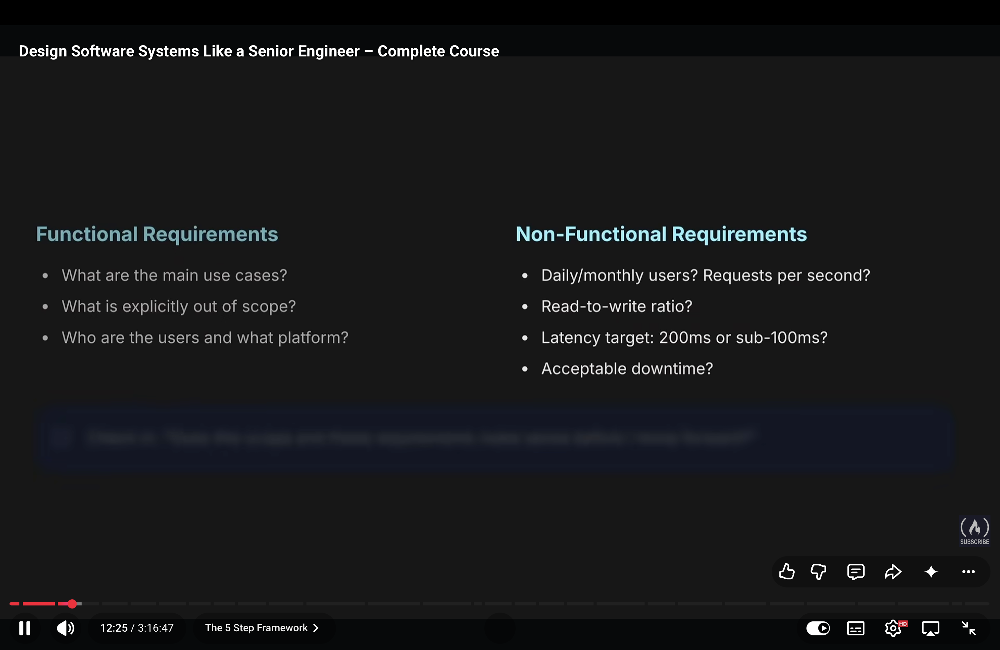
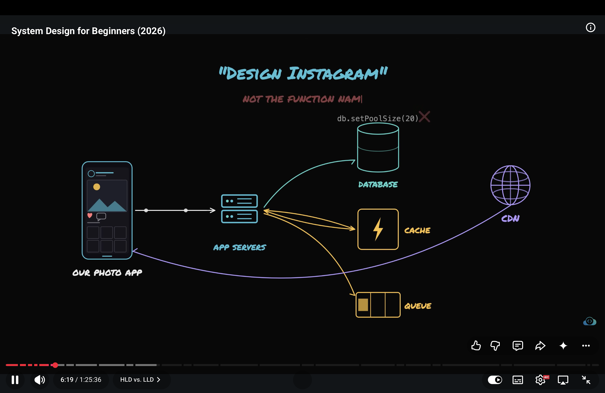
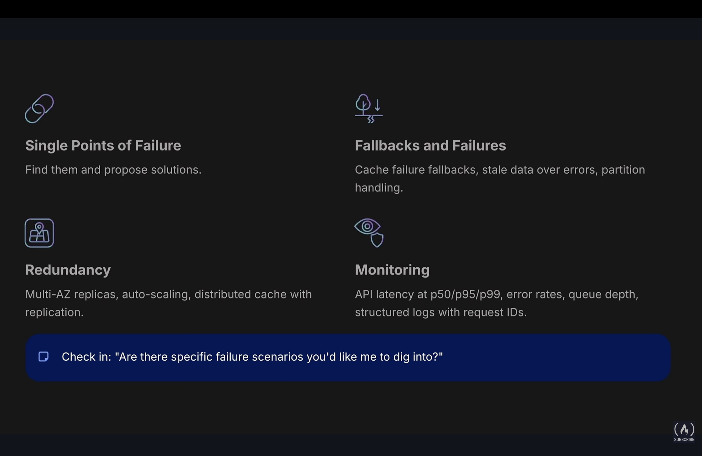
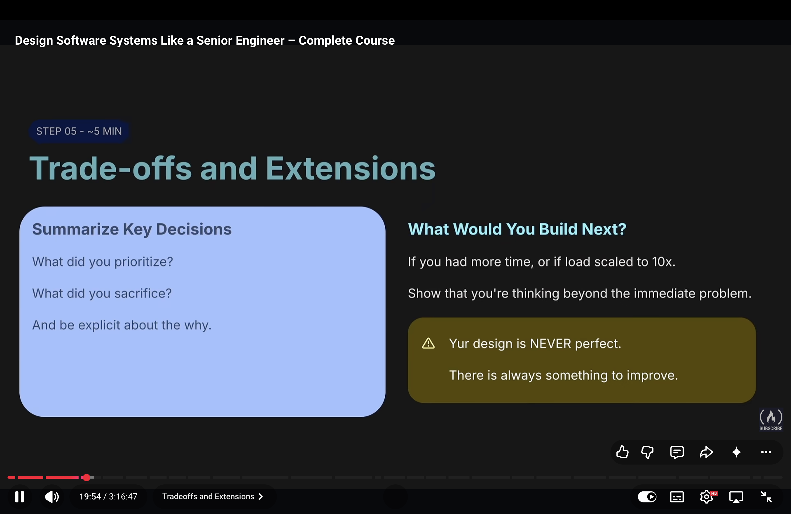
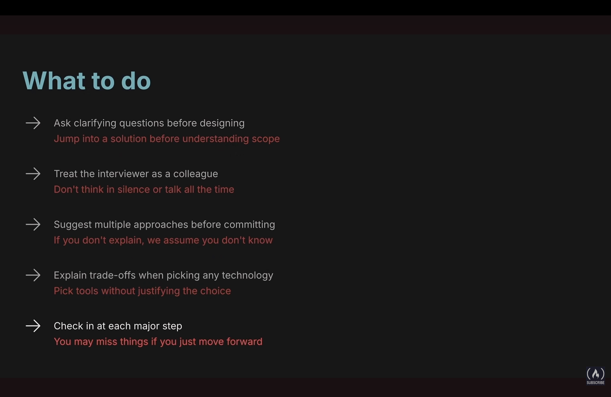
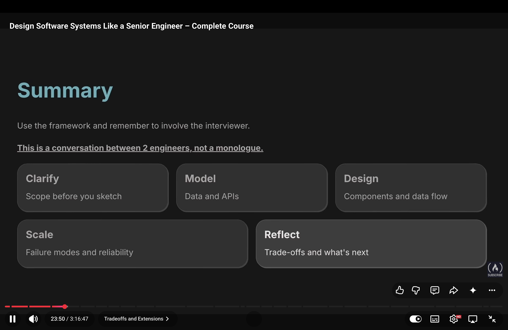

# 6 step framework.
- Every problem can be solved using these 6 steps.
1. Clarify the fun and non -fun requirements by asking the question for each step of whole system workflow and also by asking those 5 ques.  

2. Estimation -> Estimate the load, storage, processing power and find if system is write heavy or read heavy. 

3. API and DATA table -> Determine the API and Data table for system. 

4. HLD -> Desing high level diagram of system. Map out the user journey.  

5. Deep Dive -> Like how complicates part works in the system

6. Bottelneck -> Find what can fail , edge cases and scale.  

- Wrap up the system.  
- Follow these 6 steps not any other.

# What to do?
 
 