# Design Spotify.
 

1. CLARIFY:
- Spotify is the music streaming platform which allows the publisher to publish the songs and listner to listen the song.
- App have 500k users and 30 million songs

- Func req:
1. Allows admin to publish there songs.
2. Users can search and browser the song to listen it.
3. Users can maintain there playlist.
4. Users can maintain there own profiles.
5. User have to see songs recommendation on the basis of there history.

- Non func req.
1. Will use AAC and OGG audio files format.
- AAC: When building a mobile app, audio streaming platform, or general-purpose audio player.
- OGG/Opus: When building web-based real-time voice communication, games, or applications where efficient audio transmission matters.
- One. song takes 3 mb of starage.

2. What should be the playback/ read song latency?
- 1 or 2 sec max
3. Uploading/writng a song can take couple of minutes.

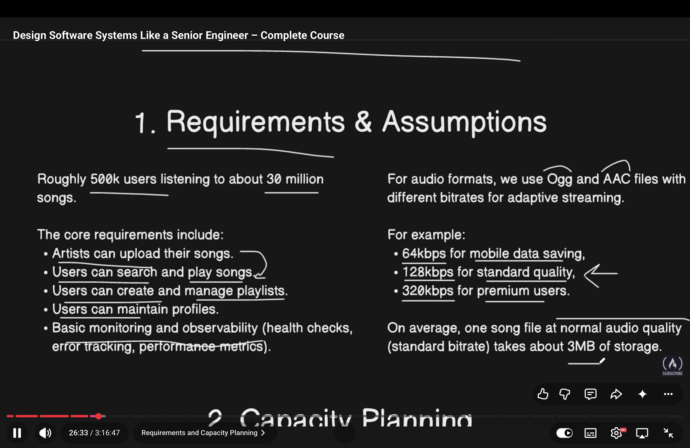 

2. ESTIMATION:
1. 500k users * 1 kb of users metadata = 500 MB for user metadata.
2. 30 million songs = 3 mb = 90 tb of stroage for songs.
3. 300 bytes per song meta data * 30 millon songs = 9 GB.

4. User listens 10 songs per day = 500k *10 = 5 million songs per day
- 5 million / 1 lakh = 50 songs per sec.
5. our app is read heavy.
-  Around 50,000 to 100,000+ simple read queries per second on modern hardware with proper indexes and memory sizing.

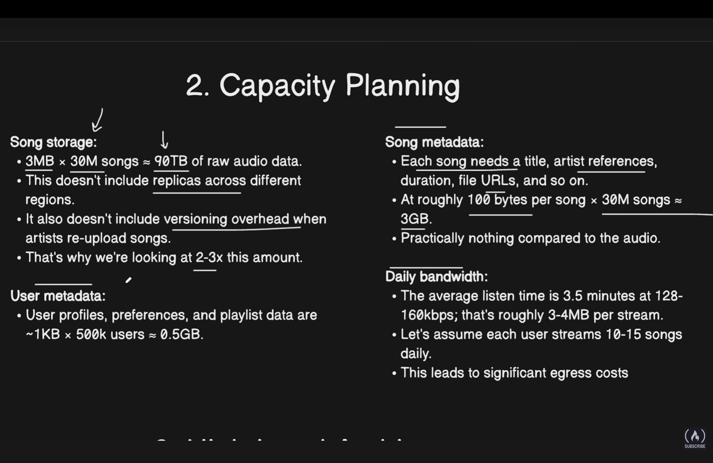 

3. API AND DATA TABLES:

# What is API?
- API stands for Application programming interface. It allows two sperate apllication to communicate with each other over HTTP protocol.
- For example frontend calling backend.
- GET /api/songs/123

# What is API endpoint?
- API endpoint is the address through which client sends req to access the resource or perform any operation.
- GET /api/v1/songs/123
- GET - HTTP method
- /api - api route prefix
- /v1 - versioning
- /songs - resource
- /123 - identify resource.

# HTTP methods
- GET, POST, PUT, DELETE, PATCH
- PATCH is used to update the field of same row.
- PUT generally send the complete new representation of the resource.
- GET, PUT, and DELETE are idempotent by HTTP semantics. POST generally isn't. PATCH may or may not be idempotent depending on the operation.

# What are resurces?
- Resource is the entity or object which our api is exposing.
- for example db have enitites we can use those db entities as resource.
- We should use resource to create api around it instead of other naming conventions.
- Because the HTTP method already tells us the operation. The resource tells us what we're operating on.

# Path Parameters.
- A path param is used to identify the particular resource.
- GET /api/songs/123
- Here 123 is songs resource id.
- Dynamic route [] -> using this we can use dynamic path params.
- catch all segment [...] -> using this multiple dynamic path params can be handled.
- When should you use path parameters?
- When identifying a particular resource.

# Query param.
- Query parameters is used to send additional information thorugh the url for searching, sorting, filtering or pagination.
- Filtering	 -  ?genre=rock
- Pagination -  ?limit=20&offset=40
- Sorting -  ?sort=popularity
- Searching -  ?q=arijit
- Multiple filters -  ?genre=rock&year=2025

- Path parameter = Identifies the resource.
- Query parameter = Filters or controls the collection of resources.

# Three ways of passing information
- Let's put everything together.
Type	Example	Purpose
Path	/songs/123	              Identify a song
Query	/songs?genre=rock	      Filter songs
Body	{ "name": "Workout" }	  Send data to create/update

# Pagination
- Pagination is the process of dividing large set of data in to smaller chunks and returning those chunks instead of sending everything at once.
- Limit and Offset pagination
- This is one of the simplest pagination techniques.

- Two query parameters are used:
- limit = How many records should we return?
- offset = How many records should we skip?
Example:
GET /api/songs?limit=20&offset=0

# Nested resource
- GET /api/artists/123/songs
- Why not just use /api/songs?
- Because we're accessing songs belonging to a particular artist.
- This is called a nested resource.
- The API reflects this relationship.
- artist -> songs
- parent resource -> child resource

# Action based endpoints
- Sometimes we want to perform an action that doesn't fit naturally into basic CRUD operations.

- POST /api/songs/123/like
This means: Like song 123.

- They are not automatically bad REST design. However, when the action represents a resource relationship, you can sometimes model it more consistently:
- PUT /api/users/me/liked-songs/123

# Your system-design interview checklist
- Whenever an interviewer asks you to design APIs, follow this sequence:
- API design workflow

1. Identify resources: 
   Do Data modelling find entities from requirements and than relate data with each toher.
   What entities exist? Users, Songs, Playlists, Artists.
   In short design scheema first
   - 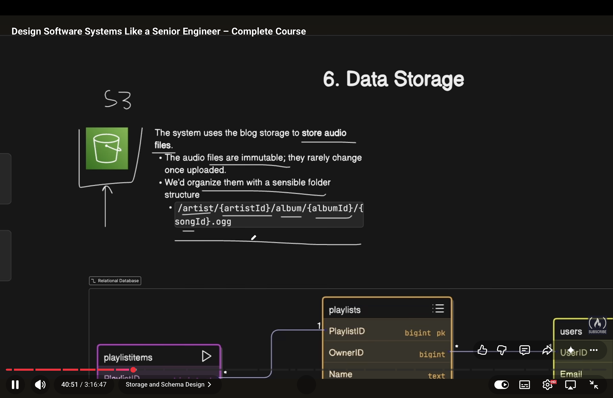 
   - 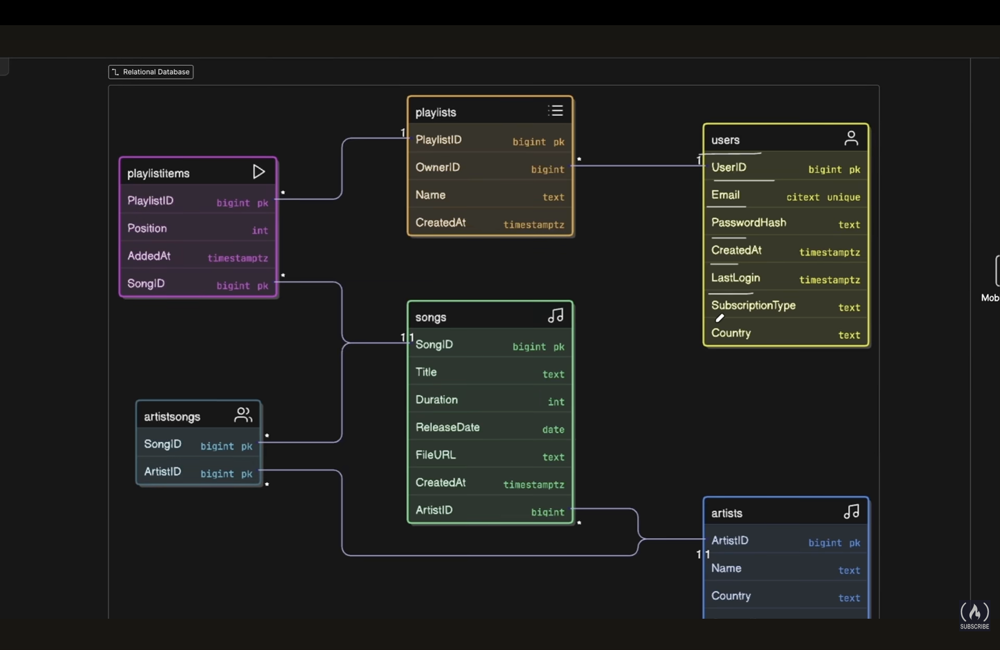 

2. Identify operations:
   FInd access pattern. What user can do? -> data operation? -> db query
   What can users do? Create, read, update, delete, search.

3. Choose HTTP methods
   GET, POST, PUT, PATCH, DELETE.

4. Define URL paths
   Use resource names and IDs.

5. Define parameters   
   Path parameters for resource identification, query parameters for filters and pagination.
   
6. Define request and response schemas  
   What data goes in and what data comes out?

7. Consider pagination
   Avoid returning millions of records in a single request.

4. HLD
- 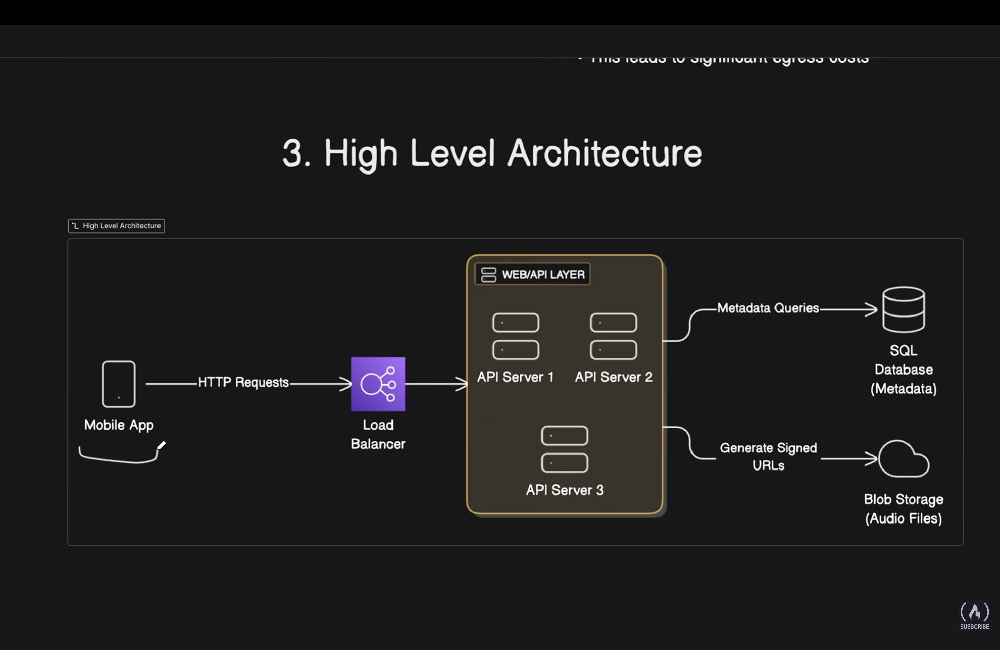
1.Ques1- Where music file is stored?
- Music file is BLOB and it is stored in S3.
- And music file metadata is stored in db.
- 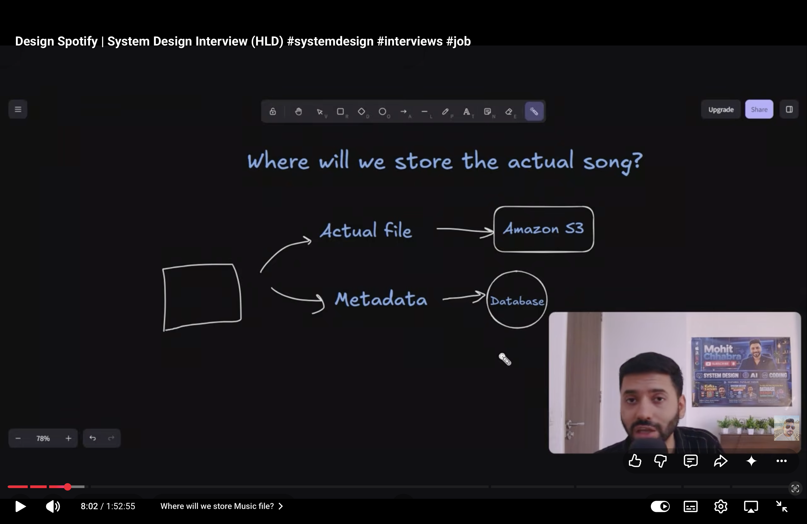

2. Ques2- Who will upload the song client or server?
- Let's say server upload the song to s3.
  In this client sends song to server, server stores it in and than send it the s3 to store it.
  If server uploads the song, it is being stored twice once in server and 2nd time in s3.

- That's why client directly stored the song in s3.

2. Ques3 - What is an Idempotency Key?
- An idempotency key is a unique identifier generated by the client for a logical API operation.
- The client sends this key along with the API request.
- The server checks whether the key already exists in the database.
- If the key exists: The server checks its status and request payload. If it has already been completed with the same payload, the server returns the previously stored response without processing the operation again.
- If the key doesn't exist: The server processes the request, stores the result along with the idempotency key, and sends the response to the client.
- Idempotency key is sued to prevent the same req from processign twice.

5. Deep Dive
- Read song spotify flow.
- 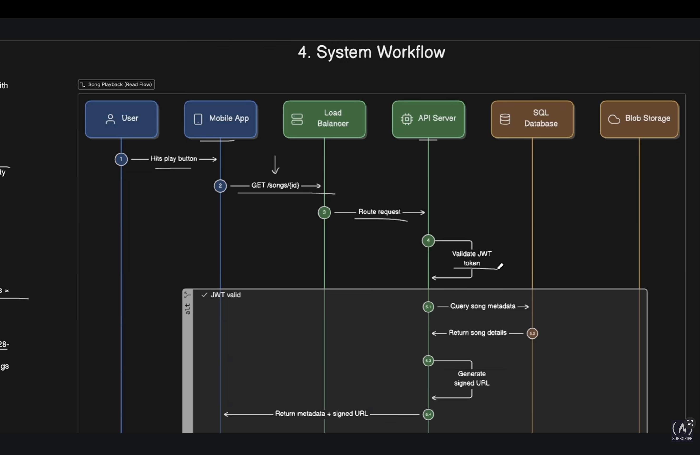 
- 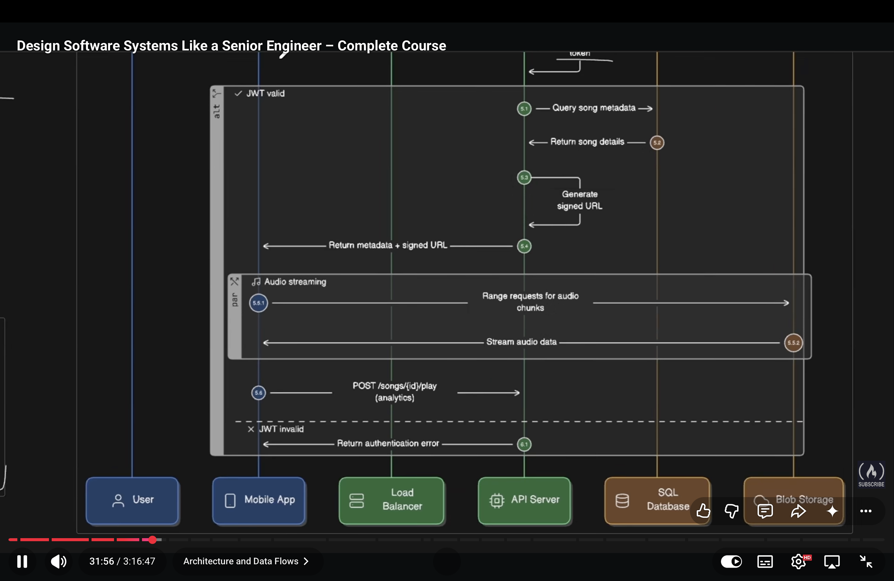 

- Write song spotify flow.
- 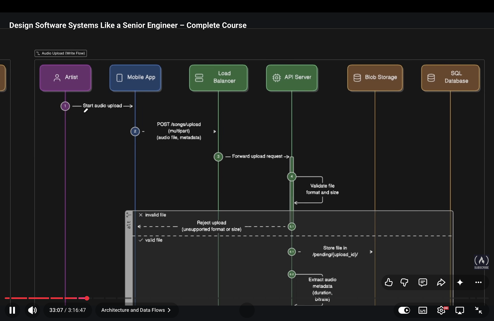 
- 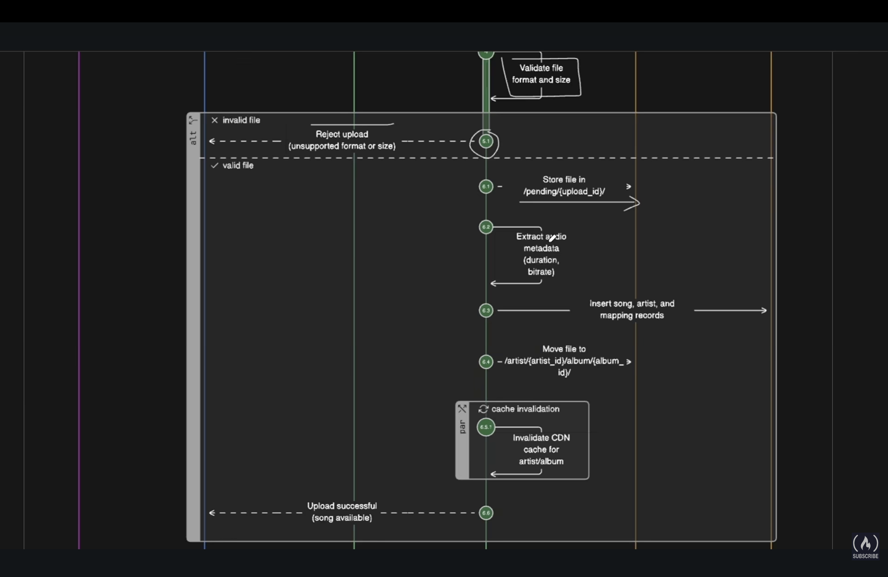 
-  

6. Bottleneck & Scalability
- 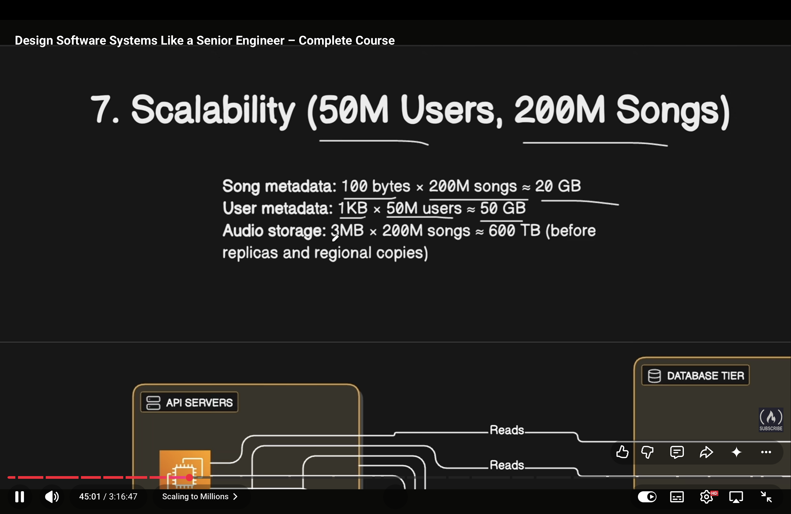 
- 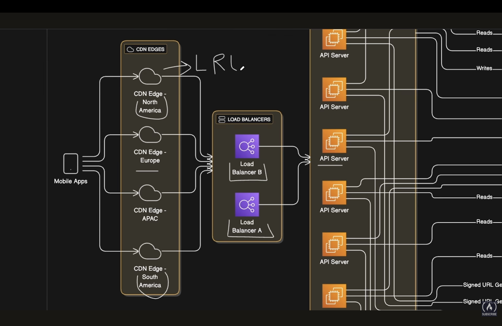 
- 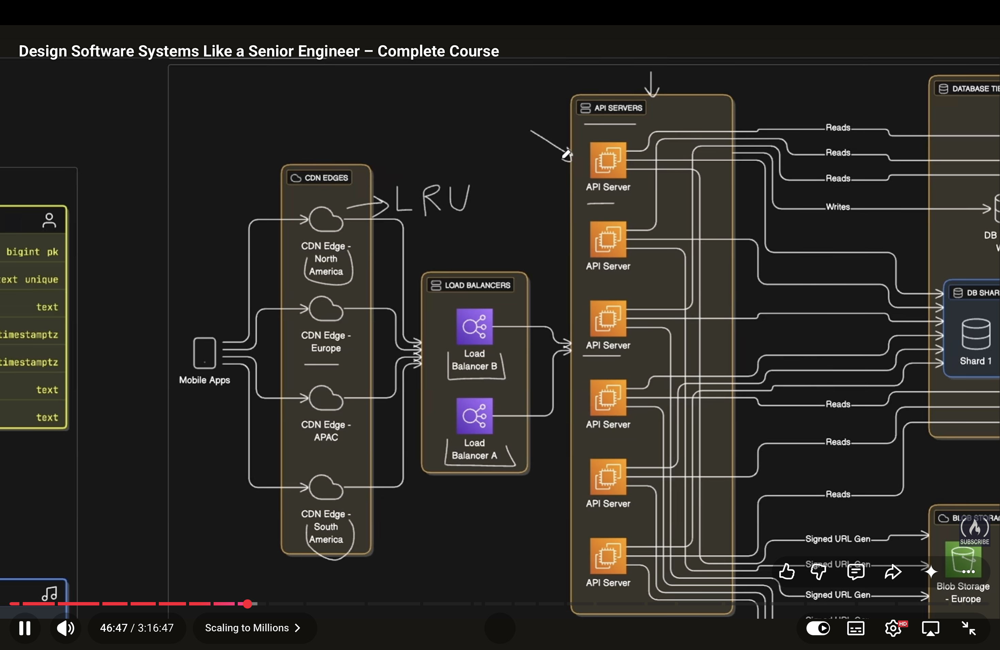
- 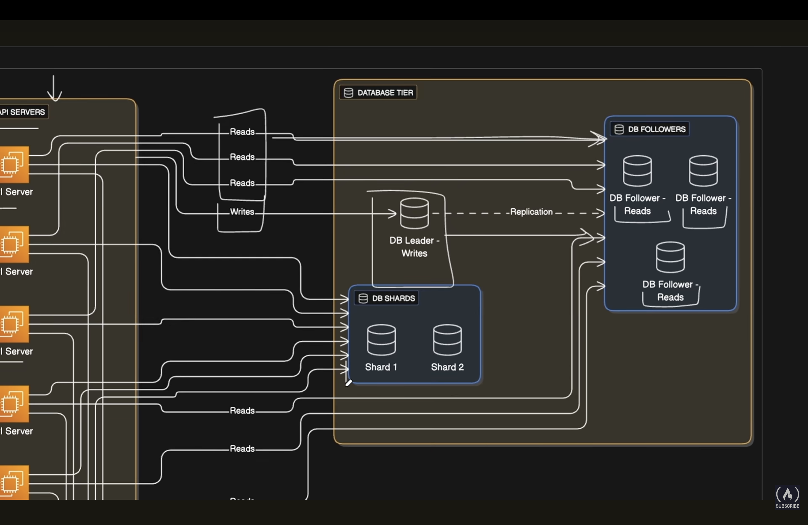
- 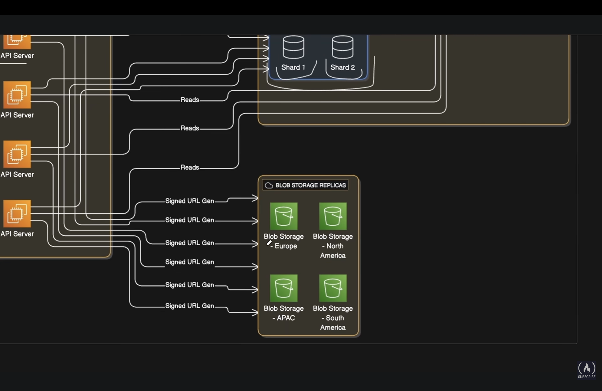
- 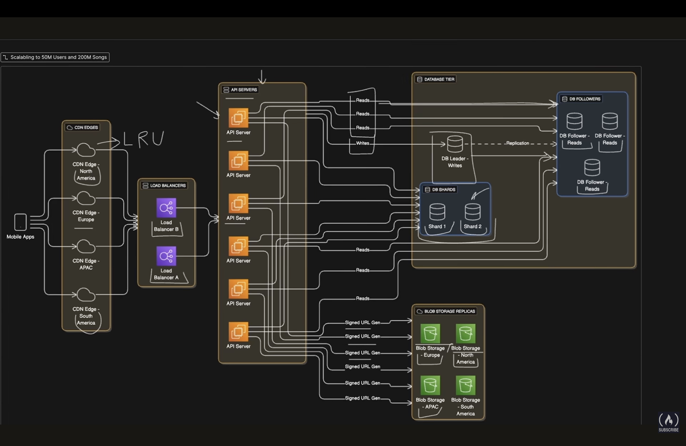    
